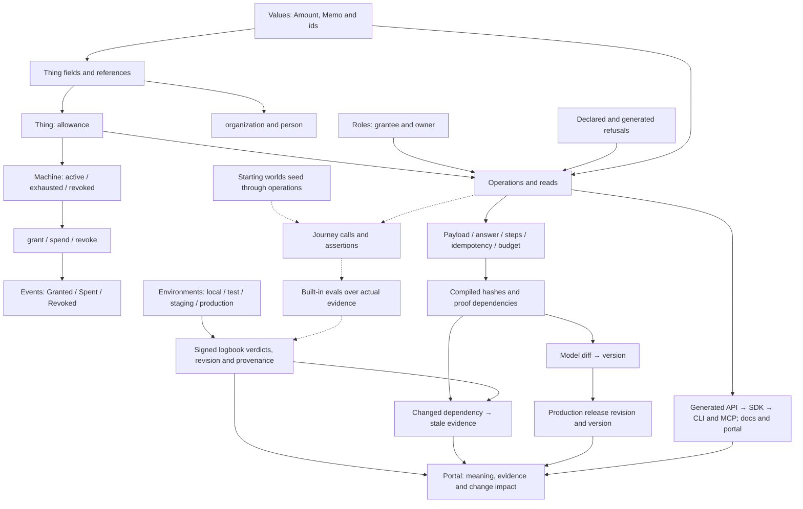

# F1: the blueprint's front end

Design decision, 16 November 2026. Designer-owned recommendation under AGENTS.md. This record specifies a frontend;
it implements no framework package. Source review is pinned to `origin/layer/3` at
`b9cc55f0bb0401d6d593024487871465b19507f5`. Design branch `design/frontend` starts at
`origin/main` `5fcd8e8837e1a4f1c385b18f92324bb10a834997`; no stage-three code is carried into this change.

## 1. Early handoff: the app-to-Architect contract

**Decision: generated, versioned JSON plus a small same-origin read adapter.** The plain L2.10 portal and the future
HeroUI face consume exactly this seam. The browser never imports project source, compiler, generators or credentials.
The adapter reads generated data and the logbook. It does not scan `blueprint/`, `src/`, journeys or git at runtime.

### What is real at the reviewed revision

- `packages/compiler/src/modules/model/types.ts:95` exports `Model`: values, things, operations, optional blanks and environments.
  `OperationModel` at line 48 contains payload, answer, move, errors/refusals, allowed roles, steps, budget and hash.
- `packages/generators/src/modules/render/service.ts:9` writes `generated/model/model.json`, `edges.json`, docs, server,
  API, SDK and CLI. The committed acme model has 8 things, 15 verbs (operations plus reads), 4 environments, 6 named values.
  Counts describe this artifact, not a fresh compile or the documentation's illustrative counts.
- `packages/logbook/src/modules/book/types.ts:6` stores only revision, environment, operation, verdict; stored rows add
  seq and verified repository/ref/workflow/event_name/sha. No timestamp, eval rows, journey results, trace ids or proof origin.
- Existing HTTP reads: `GET /verdicts`, `/verdicts/latest` (filters revision/environment/operation/ref),
  `/models/:revision`, `/releases/latest`; see `packages/logbook/src/modules/http/service.ts:18`.
  Reads are currently unauthenticated. **Do not expose that worker as the portal's public data endpoint.**
- `Compare.dependsOn` / `Compare.hashOf` own dependency staleness, not a browser's guessed graph traversal.
  The existing CLI shipped-environment staleness returns a flattened summary; the portal needs each environment separately.
- The model has no journeys, starting worlds, per-eval evidence, role predicates or lossless schemas for `type: schema`.
  `edges.json` has structural refs, acts-on, reads, emits and allowed-by edges, not journey coverage or proof dependencies.

### Files and ownership (proposed, not present APIs)

```text
generated/portal/blueprint.json   schemaVersion=1; project; revision; artifact digest; model; edges;
                                 dependsOnByOperation; generated doc text; availability markers
                                 (deterministic, made at generate/build; no wall time)
generated/portal/main.ts          tiny host entry wiring @architect/portal and generated JSON; generated header
generated/portal/assets/          package-built UI assets, copied with the project's output
```

`@architect/portal` owns the wire schema, decoder, rendering and pure status projection. The generator owns one adapter
from compiler output to that schema. At build time, emit `Compare.dependsOn(model, op)` for every operation. Runtime
compares those recorded dependencies against the matching model from the logbook; it never imports the compiler.
For historical models that predate portal projections, the portal's pure JSON adapter derives the same direct dependency
keys from operation payload/answer refs, owning-thing field refs and allowed roles. It compares their stored hashes.
That small function must have a conformance check against `Compare.dependsOn` on current and historical fixtures;
unsupported model shapes return unavailable. This keeps L2.10 usable with existing logbook models without a new compiler
runtime import or mandatory model rewrite. Generated dependency maps are an optimization, not a second authority.
Bind the exact generated model and its digest to the built revision; never label a dirty working model with a clean SHA.
Working previews carry `revision: null` and an explicit working-content digest.

```ts
// Proposed interface sketch, NOT an already available API. Wire JSON, no Effect in the browser.
type Availability<T> =
  | { state: "available"; value: T }
  | { state: "unavailable"; reason: string };
type ProofState = "recorded-pass" | "failed" | "stale" | "unproven" | "unavailable";
interface PortalProof {
  operation: string;
  environment: string;
  state: ProofState;
  evidence: Availability<StoredVerdict>; // exact existing logbook row, provenance intact
  execution: "unknown" | "executed" | "carried"; // legacy rows are always unknown
  changedDependencies: readonly { key: string; was: string; now: string | null }[];
  evals: Availability<readonly EvalResult[]>;
}
interface PortalSnapshot {
  schemaVersion: 1;
  blueprintDigest: string;
  observedAt: string; // adapter's clock, never invented from ledger seq
  consistency: "checked" | "unavailable";
  proofs: readonly PortalProof[]; // every current operation × declared environment
  release: Availability<Release | null>;
  comparison: Availability<ModelComparison>;
}
```

Names `EvalResult` and `ModelComparison` denote proposed JSON extensions, not exported framework types. For L2.10,
evals are `{state:"unavailable",reason:"logbook stores aggregate verdicts only"}`; comparison is build-time
`Compare.release` output tied to both model digests, or unavailable. JSON has no comments; its origin and digest go in
an adjacent manifest. Generated TypeScript/HTML opens with the repository's generated header. Never add invalid
`//` lines to JSON; this clarifies the header rule for these proposed data files without editing existing outputs.

### Routes (the stable surface L2.10 builds)

| Route | Returns | Stage |
|---|---|---|
| `GET /_portal/v1/blueprint` | Validated immutable blueprint.json; ETag=digest | L2.10 |
| `GET /_portal/v1/snapshot?digest=<blueprintDigest>` | PortalSnapshot for that exact blueprint; no-store | L2.10 |
| `GET /_portal/v1/traces/:id?environment=<name>` | Allowlisted TraceSource trace, or unavailable | O1 integration later |

Routes are **proposed portal routes**, not the existing logbook routes. A same-origin server adapter holds read credentials
and any private logbook URL. Authenticate and authorize project readers before cloud access; localhost binds loopback.
Reject unknown schema versions, unknown projects/environments, invalid names and digest mismatches. A digest mismatch is
409 `BlueprintChanged`, making the client reload the blueprint; no green state from a mismatched revision.
Only known routes and encoded ids are forwarded: never accept an arbitrary URL, query language or file path.
Descriptions/docs are plain text or sanitized generated Markdown; no executable project MDX in the browser.

No runtime polling of source. Fetch snapshot on navigation/manual refresh and at a bounded configured interval while visible;
replace it atomically. A failed refresh marks the last view **out of date** and unavailable, displaying its observation time.
It does not retain a green badge as though it were current. Abort in-flight requests when changing project/environment.
The observer interval is a portal entry concern; framework work still uses Timers.

### Exact selection and status rules

1. For each environment and operation, fetch the newest row **within the repository and authorized ref** (default
   `refs/heads/main`), keeping seq and all provenance. Do not filter to pass before selecting newest. A PR result is visible
   only in a separately labeled PR scope; it never fills the main matrix. Latest with verdict fail is `failed`, even if an
   older pass exists. No row means `unproven`; a failed request is `unavailable`, never unproven.
2. Retrieve `/models/<row.revision>`. Missing/invalid models or unsupported model/schema versions make status unavailable.
   For each operation require that it exists in that model. Compare its **proved** dependency set with current hashes,
   following `Compare.dependsOn(proved, op)` and `Compare.hashOf(now, key)`. Changed/missing keys make the pass `stale`, with
   the keys and both hashes returned. If all hold, `recorded-pass`; a differing revision alone is not staleness.
   Use the generated dependency map where available, otherwise the conformance-checked pure JSON adapter above.
3. Retain the operation's actual evidence revision. `recorded-pass` means exactly a recorded pass whose contract still
   matches. It does not mean a fresh run of the candidate implementation. The current hashes omit handler bodies; an
   implementation-only edit cannot be cleared as newly proven by matching blueprint hashes. Display candidate revision,
   evidence revision and the phrase "contract unchanged; candidate not rerun" whenever they differ.
4. The logbook currently has no transactional snapshot/cursor HTTP read. L2.10 adapter reads the relevant latest rows and
   latest release, fetches their immutable models, then rereads latest rows/release. Accept only if ordered seq identities
   and release identity agree; bounded retry then unavailable. `consistency: checked` means this stability check, **not**
   globally atomic storage. A future atomic logbook read can replace this behind the same response shape.
5. No current row says whether production executed journeys. D3 #97 explicitly carries staging proof to the same bundle.
   Legacy production cards say "recorded pass; execution origin unavailable". They never say "proved live in production".
   Add explicit proof origin and source revision/bundle only in an evidence extension authored and checked separately.
6. No per-eval grid of nine green checks may be manufactured from pass. Show aggregate pass and the exact missing-detail
   explanation. No trace ids, p95 samples, journey outcomes, timestamps or release versions may be invented.

### Acme JSON example: actual generated operation, proposed envelope

The following `operation` is copied byte-for-data from acme's committed generated model at the reviewed revision.
The envelope and unavailable states are proposed. No verdict or real production deployment is asserted.

```json
{
  "schemaVersion": 1,
  "project": "acme",
  "revision": "b9cc55f0bb0401d6d593024487871465b19507f5",
  "operation": {
    "kind": "operation",
    "name": "allowance.spend",
    "thing": "allowance",
    "verb": "spend",
    "identifier": "spend",
    "file": "blueprint/things/allowance/verbs/spend.ts",
    "description": "Spend from what is left of this month's allowance.",
    "payload": {
      "allowance": {
        "value": {
          "type": "id",
          "prefix": "alw"
        },
        "ref": "allowance.id"
      },
      "amount": {
        "value": {
          "type": "uint",
          "bits": 128
        },
        "named": "Amount"
      },
      "memo": {
        "value": {
          "type": "text",
          "max": 200
        },
        "named": "Memo"
      }
    },
    "answer": {
      "remaining": {
        "value": {
          "type": "uint",
          "bits": 128
        },
        "named": "Amount"
      }
    },
    "move": {
      "key": "spend",
      "from": [
        "active"
      ],
      "to": [
        "active",
        "exhausted"
      ],
      "emits": "AllowanceSpent"
    },
    "errors": [
      "AllowanceExceeded"
    ],
    "refusals": [
      "AllowanceExceeded",
      "AllowanceNotActive",
      "NotAllowed"
    ],
    "allowed": [
      {
        "kind": "role",
        "role": "allowance.grantee"
      }
    ],
    "steps": {
      "load": {
        "name": "allowance.spend.load",
        "type": "database"
      },
      "record": {
        "name": "allowance.spend.record",
        "type": "database"
      }
    },
    "idempotent": "request",
    "budget": {
      "p95Ms": 150
    },
    "hash": "40708454e868ce42"
  },
  "proofs": {
    "state": "unavailable",
    "reason": "design fixture contains no logbook rows"
  },
  "journeys": {
    "state": "unavailable",
    "reason": "compiler model has no journey projection"
  },
  "traces": {
    "state": "unavailable",
    "reason": "no retained trace supplied"
  }
}
```

### Compatible extensions

Use an additive availability-tagged `extensions` object for generated journey/world descriptions and links, exact eval
results, ratchets, traces, kits, chain and time. Unknown extension keys are ignored; incompatible core semantics bump
schemaVersion. The generator can later read declaration sources during compilation to enrich these outputs; the app
still reads only generated JSON. Prose edits and agent requests are a separate future authenticated command contract,
never a PATCH to generated JSON and never a new logbook verdict-writing capability in the UI.

Early handoff acceptance: a plain renderer and HeroUI renderer consume the same blueprint/snapshot fixture unchanged;
a latest fail, missing model, different ref, stale budget, unknown extension, schema mismatch and offline refresh cannot
show current green. The budget edit changes only `allowance.spend` when only its budget dependency changes.

## 2. What the blueprint is, and what the app is for

The blueprint makes the specification code. It declares the system's things, values, operations, machines, events,
errors, roles, journeys, environments and targets. Generation, types, lint and evals consume those declarations. The
specification is therefore structurally connected to the system built from it, instead of relying on a separate
Markdown document being kept current. Checks expose disagreement; generated outputs cannot become an independent
source of truth. This is the aim of the no-drift design, not a claim that every possible behavioural error is impossible.

Its opinions buy leverage. A complete operation declaration supplies its interfaces, constraints, instrumentation,
context and proof obligations. Architect generates the API, SDK, CLI, MCP and infrastructure where their target is
built, and scaffolds the implementation work that remains. The instrumentation is part of the generated/runtime
structure; it is not a separate task that each handler author has to remember. Debugging can follow an observed call
through declared steps, outcomes, state changes and evidence. Generators are central to the product, not a convenience
added after the frontend.

**Two loops are first-class in the portal.** Design is ideate → spike → specify until the blueprint is executable.
Build is implement → check → prove → promote → watch, with measured failure directing another bounded attempt.
A changed declaration sends its dependents around the appropriate loop again. The portal must show incomplete ideas,
open decisions and blanks as useful work states; it cannot start its story only after a finished specification exists.

The blueprint is also the foundation for the tooling that organises work. A goal can become milestones and bounded
tasks linked to declarations. The task context is derived from the operation, its dependencies, errors, events,
journeys, targets and evals. Managers can coordinate that work; workers can execute it and hill-climb against explicit
checks. Plan declarations are reviewed code; observed task/run state belongs in durable storage and the logbook,
not a generated file that changes every time someone makes progress. This follows context-pack sections 1 and 4;
it does not add a manager/task engine to today's compiler.

The portal is the human-readable artifact through which a person and agents reach agreement about that coded
specification. It is where the person shapes intent, understands consequences, follows work and judges results.
The authoritative spec remains code. A requested app edit becomes a reviewable spec change and returns through the
same generator/check/proof loop. It never creates a second, separately editable truth inside a dashboard.

Pi Durable is the selected agent execution foundation behind H1's Effect seam. Managers and workers are future
orchestration built on that foundation, not features supplied by the downloaded chat template. Durable transcripts,
checkpoints, run identities and interruption/resume states should remain visible. Cloudflare's Workers, Durable
Objects and SQLite carry the same durable theme through the runtime. Do not copy a UI's browser timer simulation
and call it a durable execution system. H1/H2's gates and the framework's five-layer sequence still apply.

This section records Aaron's clarification in this session: the portal must cover the entire lifecycle, not only
inspect/prove an already built system. His request was to restate this coherently in our own words. The record is a
restatement of that intent, with the current-code boundaries made explicit, not a new promise that managers, workers
or the visual specification editor are implemented.

The app should answer **What are we trying to build? What remains to specify? What work follows from it? What is
happening now? What is proven, and what should improve next?** A person explores in domain language, resolves asks,
reviews a proposed change, follows durable work, and sees evidence return. Code and hashes are available as reviewer
details. Documentation is a first-class route and belongs beside each thing and operation.

**Display priority:** intention and specification → derived work → evidence and improvement. The home explains the
organization/allowance/spend system and the two loops before its proof matrix. Design/work previews clearly show
which projections do not exist yet. The read-only L2.10 slice stays the floor of this larger product.

### One map, checked against the compiler



Solid links describe data present in the reviewed model/logbook or their generators. Dotted journey/world/eval links
are real declaration/runtime relationships that **are not projected into the current model/logbook JSON**. MCP is an
L2.08 output still in stage-three work, not generated by the renderer at this pinned source. Graph edges in the
fixture independently confirm refs to organization/person, actions/reads on allowance, emitted events and allowed roles.
The diagram draws semantic relationships; it does not claim the entire graph is currently serialized.

### Declaration-to-screen evidence map

All source paths in this section are at the pinned stage-three revision, not necessarily on the design branch's main base.

| Declaration/source | What survives in today's generated model | Screen and limitation |
|---|---|---|
| `blueprint/src/modules/values/types.ts`; compiler `model/types.ts:5` | id prefix, uint bits, text bound, or opaque schema marker | Type labels and named-value links; no invented schema constraints |
| `blueprint/.../things/types.ts:24`; compiler `ThingModel:29` | fields, refs, description, database/actor, hash | Thing overview; declarations, not live rows |
| `blueprint/.../machines/types.ts`; compiler `MachineModel:22` | states, moves, events, generated state refusal | Event walkthrough with all allowed source/outcome states |
| `blueprint/.../events/types.ts`, `errors/types.ts`, `roles/types.ts` | event/error fields and exit codes; role names | Expected refusal separate from defect; role predicates unavailable |
| `blueprint/.../operations/types.ts:29`; compiler `OperationModel:48` | payload/answer, steps, budget, allowed, move, idempotency, list metadata | Operation and read pages; reads have no handler |
| `blueprint/.../environments/types.ts`; compiler `EnvironmentModel:79` | identity, lifetime, secret names, destinations, promotion source | Declared configuration separate from observed deployment |
| `blueprint/.../journeys/types.ts:94` | not in `Model`; runtime scripts include closures and refs | Future compiler projection of display-safe descriptions, no serializing closures |
| `blueprint/.../blanks/types.ts`; compiler `Model.blanks` | optional map; blank operation omitted from operations | Incomplete declarations in navigation; never count omitted blanks as success |
| `blueprint/.../config/types.ts`, `identity/types.ts`, `cloud/types.ts`, `deploy/types.ts`, `secrets/types.ts` | resolved environment/config metadata, not secret values | Config summary; secret names only, no edit/reveal control |
| `compiler/src/modules/compare/service.ts:6` | operation and related thing hashes; generated edges alone are insufficient | Staleness explanations list actual changed dependencies |
| `logbook/src/modules/book/types.ts:23` | aggregate verdicts with seq and verified provenance | Per-environment evidence; no fake per-eval drilldown |

The blueprint also exports declaration helpers, checks and schema construction. They support the relationships above;
they do not each need a new navigation page. The live schema is richer than `ValueMeta`: an opaque `schema` entry must
say detail unavailable until a JSON-schema projection is generated from the declaration's authoritative codec.

Source evidence:
[Model](https://github.com/AaronAbuUsama/architect/blob/b9cc55f0bb0401d6d593024487871465b19507f5/packages/compiler/src/modules/model/types.ts#L95),
[dependency comparison](https://github.com/AaronAbuUsama/architect/blob/b9cc55f0bb0401d6d593024487871465b19507f5/packages/compiler/src/modules/compare/service.ts#L6),
[logbook routes](https://github.com/AaronAbuUsama/architect/blob/b9cc55f0bb0401d6d593024487871465b19507f5/packages/logbook/src/modules/http/service.ts#L18),
[generated outputs](https://github.com/AaronAbuUsama/architect/blob/b9cc55f0bb0401d6d593024487871465b19507f5/packages/generators/src/modules/render/service.ts#L9).

## 3. HeroUI Pro audit and the decision it supports

Full original audit, local archive hashes, source references and primary links:
[`spikes/frontend-dx/heroui-audit.md`](../../spikes/frontend-dx/heroui-audit.md).

The user supplied six archives in Desktop/gmx/zips: dashboard 1.0.13, email 1.0.14, chat 1.0.16, finances 1.0.17,
CRM 1.0.0 and a native crypto wallet 1.0.3. A delegated audit safely extracted them outside the repository, excluding
key/env files. No private package was installed. The web/native Figma kit files exist locally; their canvases were not
opened. The mocks in this PR are original HTML/CSS/JS, not copied proprietary template source or Figma exports.

The useful Pro pieces are the app layout, DataGrid, tabs, timeline, charts, code/Markdown views, chat primitives and
Tiptap-based Rich Text Editor. The chat template's send path is explicitly a timer-driven simulation
(`template-chat/src/components/chat-composer.tsx:77–92`); there is no Pi backend to adopt. Its display components
can show explicit agent actions and tools, not private chain of thought. CRM supplies a useful detail view pattern;
email supplies a responsive list/detail pattern; finances supplies charts when real measurements exist. The native
wallet uses a separate Expo stack and is not a browser portal dependency.

| Blueprint view | Pro/OSS pieces to use | Domain work Architect owns |
|---|---|---|
| System home | AppLayout, navigation, DataGrid, status chips | Semantic thing map, environment scope, honest proof denominator |
| Thing | Tabs, field tables, detail layout | Machine/event walkthrough; state is not a cosmetic progress bar |
| Operation/read | Tables, code block, Markdown, timeline | Payload/answer/refusal/role semantics and evidence joins |
| Journeys/worlds | Stepper, timeline, list | Expected vs actual calls, assertions and cleanup evidence |
| Environments/releases | Select/segment, DataGrid, timeline | Revision applicability, model diff, artifact identity |
| Docs/prose | Markdown, TOC, rich editor later | Single generated document source; sanitized rendering and reviewed edits |
| Change conversation | Chat shell, PromptInput, tool/source presentation | Durable request, isolated agent work, actual diff, check/prove/merge states |
| Later kits/chain/time | Tree, timeline, agenda, tables | Kit origin, signer/receipt/follower facts, due/actual/lateness |

**Version evidence.** The archives use `@heroui-pro/react: "latest"` and have no lockfiles. They pair it with OSS
HeroUI 3.2.6. Public beta.11, published 30 October 2026, moves Sheet into OSS 3.2.7 and raises Aria peers. A fresh
archive install is not a valid dependency plan. The audit records an age-eligible candidate cohort (Pro beta.11,
HeroUI/styles 3.2.7, React/DOM 19.3.1, Aria 3.53.1/components 1.22.1/stately 3.51.0, Tailwind 4.3.3), all published
before 2 November. Full protected-package peers, all transitive ages and runtime behaviour remain to be verified.
No dependency is added or pinned by this design change. Implementation must use exact pins and the repository's
`minimumReleaseAge: 20160`, resolve a lockfile, and run the target integration check before accepting the cohort.

Pro's styling shares the OSS variable system; Mouve, Glass and Brutalism are available themes. Choose the neutral
product shell and restrained blue actions in this spike as a proposal within HeroUI's component vocabulary. Keep
status meaning independent of the theme. The local web kit is `HeroUI Pro Figma Kit V3-v1.0.5.fig`; access to its
frames is a later visual-fidelity check, not proof that this mock is a Figma-approved comp.

**Distribution decision.** The default distributable `@architect/portal` ships original code using OSS primitives.
A project licensed for Pro can select a project-owned Pro face later, consuming the same wire contract. Do not copy
Pro source into a public framework package or commit its archives/kit. Current published terms restrict source
redistribution; possession of the archives does not establish the applicable entitlement or permitted framework
packaging. This is a concrete packaging boundary, not a legal opinion about Aaron's plan. Pro remains the intended
licensed app face; distributing it waits for the actual entitlement/distribution terms.
[Official licensing](https://heroui.pro/docs/react/getting-started/licensing),
[terms](https://heroui.pro/terms), [beta.11](https://heroui.pro/docs/react/releases/beta-11).

## 4. The DX, view by view

Open [`spikes/frontend-dx/index.html`](../../spikes/frontend-dx/index.html) directly. It needs no server or account.
All names, types, relationships, errors, roles, steps, budgets and destinations are taken from the pinned acme model.
Synthetic evidence and agent activity are persistently labeled as illustration; the default contains no proof rows.
The same original shell has desktop/mobile layouts, native keyboard controls and visible focus. These are reviewable
mocks, not a HeroUI runtime implementation or a demonstrated agent journey.

| View / mock hash | What a person does | What they see / next action |
|---|---|---|
| Home `#home` | Understand acme, then inspect trust | Organization-owner → allowance-member → spend; model scope; allowance evidence matrix; missing evidence; links to docs and change |
| Thing `#thing` | Open allowance; walk grant/spend/revoke | Five real fields; organization/person refs; three states; all move outcomes and emitted event; operations/read; roles; errors; docs |
| Operation `#operation` | Inspect allowance.spend | Exact payload/answer fields, role, idempotency, expected refusals, steps, 150 ms p95 target, evidence per environment; no fabricated measured p95 |
| Journeys `#journeys` | Follow a world into calls and assertions | Current missing-projection state; proposed seed/cast/call/assertion/run/cleanup anatomy, explicitly future |
| Environments `#environments` | Compare declared destinations | Four identities/lifetimes/promotion settings; production domains shown as declarations, with observed deployment unavailable |
| Releases `#releases` | Understand version impact | Missing real release baseline; illustrative budget 150→120 patch; actual release number stays unavailable |
| Specification `#design` | Follow ideation, spikes and specification readiness | Real operation declarations and recorded blanks only; idea/decision history unavailable until projected; generation relationships visible |
| Work `#work` | Inspect what the blueprint supplies to a worker | Real spend context, independent author obligations and future manager/worker anatomy; no invented milestones, assignments or live runs |
| Docs `#docs` | Read how spend works without reading TypeScript | Reader view beside generated Markdown; direct link back to contract and evidence; exact source document retained in fixture |
| Later `#future` | Understand what will appear after gates | Kit origin/config/operations, contract/signature/receipt, clock/due/actual/lateness anatomy; no live future controls |
| Change loop `#loop` | Enter request; inspect patch and failure/recovery | Explicit authored preview: proposed budget diff; omitted-generation failure; corrected patch; review; returned-evidence explanation |

The four required screens are home, thing, operation and two-way loop; the other screens make the surrounding DX
reviewable. The prototype's linked detail screens are allowance and spend, not a claim that every possible thing page
has been implemented. There are no deploy, wallet-sign, secret-reveal or fake "prove now" controls.

### Operation information hierarchy

The top explains the promise in ordinary language. Then payload and answer, who may call, state/event effects and
refusals. The evidence section states candidate revision, evidence revision, environment and origin before a green
badge. Evals, traces and measured budget are subordinate drilldowns with availability state. The raw blueprint path,
SDK/HTTP/CLI examples and hashes belong in expandable review details and docs, not in the basic user task flow.
A read uses the same page shape but says it does not mutate state and needs no handler. `type: schema` never becomes
an invented list of values. `Amount` is uint128; it is not labelled dollars, ETH or a token without a declaration.

### Two-way loop: a requested change is not a direct edit

```text
request(base blueprint digest, scope, prose, idempotency key)
  → accepted request id
  → isolated agent copy / explicit file allow-list
  → proposal(actual diff, affected declarations, predicted stale proofs, version impact)
  → author-owned journeys/checks, where contract behaviour changes
  → generate → check → prove on the exact candidate
  → review / green pull request / merge under repository policy
  → regenerate portal + refresh signed evidence
  → separately promote the exact artifact through environment gates
```

This is a later command seam, not an L2.10 endpoint and not a permission granted by the read adapter. Requests have a
base digest and idempotency key. Replayed submission yields the same request; moved base requires rebase/review.
States are `requested`, `working`, `proposal`, `checking`, `awaiting-review`, `merged`, `failed`, `cancelled`.
An interrupted or budget-limited run stays failed/interrupted with its durable request id, never "done" because chat
stopped streaming. H1/H2 own run/transcript storage and scoring. The UI shows committed activity summaries, source
links, cost/turn limits and checks; it never invents a backend from the supplied chat demo.

An editable prose block is a **draft request**. Store the editor's JSON in the request service until accepted; an agent
converts it to canonical blueprint/doc changes in a reviewable patch. Generated Markdown remains the display source.
No direct mutation of generated files or verdicts; no second authoritative document store. If a field needs a business
operation rather than a blueprint change, send it through the generated SDK as that principal instead of a code agent.
In L2.10 the entire site remains read-only. Its only later write exception is answering an explicit ask through the
ask service; that does not give chat, code writes or promotion authority.

## 5. Where it lives; what is generated; framework and hosting

**Decision: React Router in the browser, an Effect read adapter on workerd, and Fumadocs components for docs.**
Build the UI as package-owned static assets with Vite. Use React Router's declarative/data routing for the app; avoid
server-framework coupling in v0. Generate only per-project data, assets and a tiny composition entry. The framework
packages never run a project's compiler/generator in production. Do not turn each generated project into a copied
Next template with its own divergent frontend logic.

| Shipped once in `@architect/portal` | Generated per project |
|---|---|
| wire decoder, pure read/status adapter and original renderer | validated blueprint, edges, dependency maps and docs |
| route components, accessible fields/machine/evidence views | project/revision/digest manifest; capability availability |
| compiled browser assets and Fumadocs component integration | copied assets and generated host entry with typed bindings |
| host handler over injected logbook reader/Clock/asset binding | destination configuration from environment, secret names only |

Pro face is a later project-selected renderer, subject to the distribution evidence above, not a second contract.
`generated/portal/main.ts` is the generated composition root and imports `@architect/portal` only for portal runtime.
This is a narrow addition to the existing generated-runtime package whitelist (which currently names target-effect,
blueprint, host and project code). L2.10's builder must encode that scope in Nx rules and its test; application handlers
must not gain portal or compiler dependencies. Package sources keep the six-slot module layout, under 250 lines per
file; this spike does not pre-create those modules.

The portal's on-disk source is owned by Architect under `packages/portal` when the step is built, and the project's
result under `generated/portal`. The renderer can be replaced without changing the model/evidence seam. `design/packages.md`
already assigns `@architect/portal` to layer 2. Stage three of the local goal is **framework layer 2**, not framework layer 3.

### Concrete alternatives

```ts
// A — recommended: one face over generated data; named portal host entry is the effect boundary.
Portal.serve({ blueprint: generatedBlueprint, logbook: injectedReader, assets: injectedAssets })
// browser: React Router routes consume decoded blueprint + PortalSnapshot
```

```ts
// B — a copied Next application per project.
// app/thing/[name]/page.tsx loads model and logbook; every project carries its own server/UI dependency tree.
// Cloudflare deploy additionally needs a compatible Next/Workers adapter and its own integration proof.
```

```text
C — independent hand-written portal per project
project-ui reads project source, computes its own proof state and owns another set of schemas
```

A follows D3's read-only workerd site and the package/generation split. B gives the closest unmodified template
experience but couples app output to Next server semantics and duplicates frontend sources. C loses the source-free
contract and is rejected. This is a design decision now, not a framework package installation.

### Docs and local/cloud serving

Fumadocs offers headless components and a React Router path; use TOC/search/code/document components inside the
HeroUI shell, with scoped styles. Compile generated Markdown into safe display data at build time. Do not execute
project-provided MDX on the request path. A block-editor draft is not a live replacement for these generated docs.
A later integration check must verify the installed version's exports, style layering, deep links and static search.

Locally, `architect generate` writes the project artifacts; the portal host serves the app at **`/portal`**, preserving
D3 #16 and the author's existing Gate 2 expectation. Browser paths underneath `/portal` fall back to its shell;
`/_portal/v1/*` remains real JSON/error routes, never an HTML fallback. The named portal host entry wires injected
Clock/logbook/asset services. `env up` starts it under existing environment lifecycle and `env down` closes its ports.
No new independent dev daemon is required. L2.10 can initially render plain HTML from the same wire data.

In the cloud pass, upload the already-built assets with a thin Worker and the exact generated data. Route protected
HTML **and JSON/data/search assets** through project authorization before static serving; hashing a URL is not access
control. A public-docs projection is a separate explicit allowlist, never the whole private snapshot. Keep provider
read tokens in host bindings. Deployment needs the cloud pass's existing authorization and credentials; this design
creates no accounts, credentials, world, site or cloud bill.

React Router SPA output and Workers Static Assets are documented. If using React Router *framework* mode with
`ssr:false`, build it outside Cloudflare's framework Vite plugin: Cloudflare currently documents that combination as
unsupported. The recommended browser-only router plus independently built assets avoids that plugin path. SSR is a
later measured need, not a prerequisite for this read-only app. Next on workerd remains possible only after proving
its actual adapter/bundle against the pinned version, not because the downloaded templates import Next.
[React Router SPA](https://reactrouter.com/how-to/spa),
[Workers static assets](https://developers.cloudflare.com/workers/static-assets/),
[Cloudflare framework limitation](https://developers.cloudflare.com/workers/static-assets/migration-guides/vercel-to-workers/react-router/),
[Fumadocs headless](https://www.fumadocs.dev/docs/headless),
[Fumadocs static React Router guide](https://www.fumadocs.dev/docs/react-router/deploying/static).

Age-eligible optional candidate: React Router 8.5.1 plus Fumadocs core/UI 16.17.9 and React/DOM 19.3.1. Inspected npm
peer ranges permit the combination; runtime exports, CSS and workerd have not been executed. Candidate versions are
not installation instructions. Resolve and test the complete closure under the age rule in the implementation step.

## 6. Rubric: alternatives graded against the real seam

Grades: 3 = strong, 2 = acceptable with named work, 1 = weak, 0 = violates the brief. Higher blast-radius score means
smaller change. These are reasoned design grades, not measured performance.

| Option | Floor-first | Reversible | Blast radius | Correctness / integrity | Parallelizable | Fit |
|---|---:|---:|---:|---:|---:|---:|
| A: generated JSON + live same-origin adapter; plain face now | 3 | 3 | 3 | 3 | 3 | 3 |
| B: browser reads raw model/logbook and computes everything | 2 | 2 | 2 | 1: no auth/projection seam | 2 | 1 |
| C: new all-purpose portal backend and database first | 1 | 2 | 1 | 2 | 1 | 1 |
| D: snapshot file only, no logbook refresh | 2 | 3 | 3 | 1: proof goes stale silently | 3 | 1 |

| Renderer / home choice | Floor-first | Reversible | Blast radius | Correctness / integrity | Parallelizable | Fit |
|---|---:|---:|---:|---:|---:|---:|
| Original static face then browser React Router package | 3 | 3 | 3 | 3 | 3 | 3 |
| Copy a Pro Next template into each generated project | 2 | 1 | 1 | 1: unresolved pins and rights | 2 | 1 |
| Build full Figma library and agent editor before read portal | 1 | 2 | 2 | 2 | 1 | 1 |
| System/promise overview with contextual evidence | 3 | 3 | 3 | 3 | 3 | 3 |
| Proof KPI dashboard as the entire home | 2 | 3 | 3 | 1: hides what was promised | 3 | 1 |

Recommendation: the generated contract, system-first home and small original read-only face now. They provide a real
L2.10 floor, keep the stage-three builder independent of paid access, and allow the licensed Pro renderer to replace
the face. Rich docs, agent editing and later target views are additions behind explicit capabilities and gates.

## 7. Build-step proposals (record only; build-plan.md is not edited)

| Proposed step / placement | Depends on | Deliverable | Done when |
|---|---|---|---|
| L2.10a — portal wire projection | L2.04, L2.P | versioned blueprint/schema, generated docs and model identity | Acme output is deterministic; app imports no source; unknown schema/digest mismatch rejects; historic model projection matches Compare |
| L2.10b — snapshot adapter and plain portal | L2.10a, existing logbook | per-env proof/provenance, stale reasons, stable-read check, `/portal` | Real signed test/staging rows show on spend; changing its budget makes spend stale only; latest fail wins; logbook outage and absent model never become green; cleanup leaves no port/world |
| L2.10c — gate integration | L2.10b, author's Gate 2 checks | author-owned journeys/checks and evidence | Existing portal Gate 2 check passes on the local stack; revision/ref/digest, carried evidence and offline cases covered by independent author; no paid model runs needed for this design |
| F1.1 — licensed face and docs | L2.10 on main; licence scope; Figma if chosen | age-pinned React Router/HeroUI face and Fumadocs components | Same wire fixtures render unchanged; keyboard + mobile + direct URLs + sanitized Markdown/static search pass; no package secrets or Pro source redistributed |
| F1.2 — richer generated evidence | read portal on main, independent author | journey/world/eval/ratchet projection; explicit executed/carried origin | Named acme journeys link to exact operation/revision/evals; missing result stays missing; production shows its real source proof |
| F1.3 — trace drilldown | O1 reader and L2.P | portal adapter over TraceSource, sink-independent trace view | Same trace tree from supported sources; expected refusal separate from defect; private attribute fixture absent; unsupported source clearly unavailable |
| later.md — planning and durable orchestration | H1/H2; declared work primitives and independent checks | code-declared goals/milestones/tasks, derived context and manager/worker run projections | Task context derives from real declarations; plan changes are reviewed; checkpoint/resume and run state survive interruption; no fabricated work history |
| later.md — two-way requests / prose / agent face | H1/H2 harness and an explicit request-service step | durable requests, draft editor, reviewed diff and prove/merge lifecycle | Base conflicts, repeated submits, failed proof, interruption and budget cap cannot falsely complete; independent journey authors remain protected; no browser verdict writes |
| L3 view extension | Gate 2 on main, L3 kit model | kit source/config/dependency links | A fixture kit's generated operations appear without hand-maintained page definitions |
| L4 view extension | Gate 3 on main, chain target | network/contract/ABI/signature/receipt/follower views | Real local Anvil evidence links to exact environment and bytecode; no mock receipt labeled real |
| L5 view extension | Gate 4 on main, time model/eval | due/actual/anchor/lateness view | Month-from-grant and expiry journeys display actual on-time evidence; delayed keeper shows lateness |

No later primitive is implemented by this spike. Stage-three package code and all `layer/*` branches remain untouched.

**Built since (17 November 2026, build/L2.10):** L2.10a, L2.10b and the local half of L2.10c, as `D3.md` decisions #130 to #137 record, with the
evidence in `design/evidence/L2.10/`. Where the build departs from this record: the portal is a route of each environment's Worker (`/portal`,
`/_portal/v1/*`), not a separate site; "current" for staleness is the newest revision proved in `test`, else the bundle's model (#132); and
`Wire.build` and the JSON dependency adapter live in `@architect/portal`, with the conformance test in `generators` (#134). F1.1 onward is not built.

## 8. Validation and scope

See [`spikes/frontend-dx/README.md`](../../spikes/frontend-dx/README.md) for the runnable validation, browser inspection,
screenshots and independent review receipt. The original model/edges/docs fixtures are retained with hashes and the
exact source revision so a later designer can reproduce the information rather than trust a screenshot.

This is source review plus a tested static design artifact. It is not a fresh acme compile, a full framework prove,
a deployed portal, Figma approval, a Pro package install, or an end-to-end agent change. No tokens were requested,
read, printed or committed; none were needed to inspect the supplied archives. Nothing is left running.

## 9. Questions for Aaron (batched, for the later implementation)

The design has no remaining access blocker. The local archives were sufficient for the audit and static mocks were
expressly permitted by the brief. These are the two access details only Aaron can supply before the licensed face:

1. **Pro distribution scope.** Which current entitlement or vendor permission covers a reusable project-generated
   portal face? Concrete choice: keep original OSS `@architect/portal` plus project-owned licensed Pro integration
   (recommended above), or obtain terms expressly covering framework distribution before putting Pro material into
   the package. Evidence: archive `package.json` uses `"@heroui-pro/react": "latest"`; the renderer/generator seam is
   `packages/generators/src/modules/render/service.ts:9`; all generated projects consume the chosen face. Original
   package + optional licensed project face scores 3/3/3/3/3/3 on the rubric; distributing the copied templates before
   entitlement is known scores 2/1/1/1/2/1. No token should be pasted into chat or committed.
2. **Figma destination, if frames are wanted next.** The concrete baseline is the reviewed static home/thing/spend/
   change screens in this spike. The local web kit exists but was not imported. A new file imported by Aaron from
   `Desktop/gmx/figma/HeroUI Pro Figma Kit V3-v1.0.5.fig`, shared through his account, allows exact kit-instance frames;
   staying with original static mocks is already valid for this brief. Static-first scores 3/3/3/3/3/3 for this step;
   holding L2.10 until library import scores 1/3/2/2/1/2. No Figma access token is needed for the completed design spike.

These are recorded follow-up questions, not reasons to block the read-only contract or start package work early.
