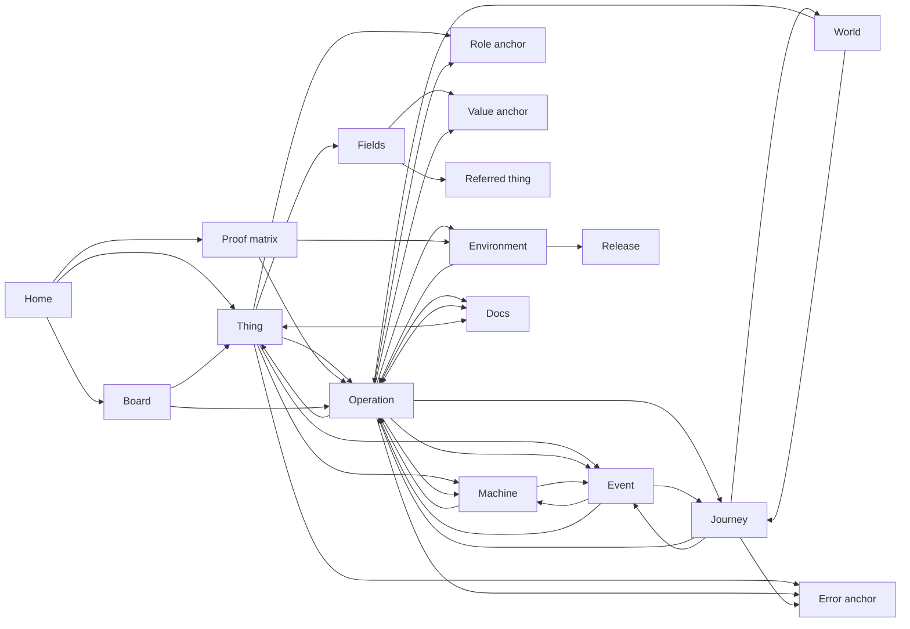

# F2: the portal's information architecture

Design decision, 17 November 2026, by the 📐 UX thread run from `design/briefs/F2-portal-ia.md` (on `origin/layer/3`).
Designer-owned recommendation under AGENTS.md. It builds on F1 (`design/decisions/F1-frontend.md`) and changes no
package. Every claim about the blueprint cites `origin/layer/3` at `92bb0faa9529f1c81334650cff09670cf6e36d5a`
(paths below are on that revision unless they start with `spikes/portal-ia/`).

**The answer in one paragraph.** Organise the portal as a **catalog of things** (each thing is the hub for its fields,
machine, operations, events, errors and roles), with three **lenses** over the same declarations: proof (environments,
journeys, the matrix), work (a derived board) and docs (Fumadocs). The environment is a **global scope switcher**, not a
section. The graph is a **local neighbourhood view** on each page, not the navigation. Everything is reachable in two
clicks from the home: "why is spend stale in staging?" is home matrix cell, then the operation's staleness explainer.
The mock is `spikes/portal-ia/index.html`; the four options are drawn in `spikes/portal-ia/sitemaps.html`.

## 0. Inventory: every declaration kind, every attribute, where it lives

Where a fact lives decides what a page can honestly show. **model** = `generated/model/model.json`, built in
`packages/compiler/src/modules/model/internal/describe.ts` and `environments.ts`; **edges** = `generated/model/edges.json`
(`packages/generators/src/modules/render/internal/docs.ts:83-94`); **logbook** = verdict and release rows
(`packages/logbook/src/modules/book/internal/sql.ts:3-12`) plus one model per kept revision in R2
(`packages/logbook/src/modules/http/internal/stores.ts:10`); **telemetry** = span and log attributes written by
`target-effect` and read by `prove`; **prove** = read from source by prove at run time, never projected
(`packages/prove/src/modules/journeys/internal/load.ts:20-47`); **none** = not projected anywhere.

The compiler skips journeys and starting worlds on purpose: `LATER = ["starting-worlds", "journeys"]`
(`packages/compiler/src/modules/model/service.ts:9,16`). `architect.config.ts` is read by nothing yet.

| Kind | Attribute (declared at) | Lives in | Model path |
|---|---|---|---|
| value | name (export, `compiler/.../layout.ts:43`) | model | `values.<Name>` |
| value | meta: `id` prefix / `uint` bits / `text` max / `schema` (`blueprint/.../values/types.ts:9-18`) | model | `values.<Name>`, inlined into every field as `value` |
| value | schema codec (`values/types.ts:7`) | src | not projected; `type: schema` must say "detail not projected" |
| value | visibility (`values/types.ts:11`) | model, on fields only | `fields.<k>.visibility`; absent on `values.*` |
| thing | name, identifier (folder, `layout.ts:58`) | model, edges | `things.<t>.name/identifier` |
| thing | description (`things/types.ts:24`) | model | `things.<t>.description` |
| thing | fields (`things/types.ts:25`) | model, edges | `things.<t>.fields.<k>` `{value, named?, ref?, visibility?}`; `refers` edge |
| thing | lives `database \| actor` (`things/types.ts:27`) | model | `things.<t>.lives` |
| thing | code prefix (`things/types.ts:29`) | model | `things.<t>.code` (`codes.ts:16`) |
| thing | hash (`describe.ts:82`) | model, logbook model | `things.<t>.hash` |
| field | of, key, value, from, visibility (`things/types.ts:6-15`) | model, edges, telemetry | public fields only become span attributes |
| operation | name, verb, file (`layout.ts:78-83`) | model, edges, logbook, telemetry | `operations.<t.v>`; verdict `operation` column; span name |
| operation | description, payload, answer (`operations/types.ts:40-42`) | model, telemetry | `payload`, `answer`; public fields as span attrs |
| operation | move (`operations/types.ts:43`) | model, edges, telemetry | `move {key, from, to, emits}`; `emits` edge; spans `move.name`, `move.to`, `event.name` |
| operation | errors (`operations/types.ts:44`) | model, telemetry | `errors`; derived `refusals` = errors + machine notFrom + `NotAllowed` (`describe.ts:114-120`) |
| operation | allowed (`operations/types.ts:45`) | model, edges | `allowed [{kind: anyone \| signed-in \| role \| role-of, role?, path?}]`; `allowed-by` edge |
| operation | steps (`operations/types.ts:46`, kinds at `:19`) | model, telemetry | `steps.<k> {name, type}`; child span with `step.kind` |
| operation | idempotent, budget p95 (`operations/types.ts:47-48`) | model, prove | `idempotent`, `budget.p95Ms`; performance eval is review-only |
| operation | runs, test (`operations/types.ts:50-52`) | model | `runs: "server"`, `test: unit \| network` (`compiler/.../model/types.ts:75-77`) |
| operation | hash (`describe.ts:131`) | model, logbook model | `operations.<o>.hash` |
| read | by, fields, where, order, page, allowed, budget (`operations/types.ts:102-123`) | model, edges | `kind: "read"`, `list {where, order, page}`; `reads` edge; no move, steps or handler |
| machine | states, moves, notFrom.exit (`machines/types.ts:30-49`) | model, telemetry | `things.<t>.machine`; notFrom becomes `{error, exit, code: "<P>-900"}` (`codes.ts:52`) |
| event | name, fields (`events/types.ts:5-13`) | model, edges, telemetry | `things.<t>.events.<E>`; public fields in the journal (`move.ts:68-70`) |
| error | name, fields, exit (`errors/types.ts:12-20`) | model, telemetry | `things.<t>.errors.<E> {fields, exit, code}`; `refusals.<E>`; span `refusal` |
| error | `NotAllowed` built in (`errors/types.ts:41-42`) | model | `refusals.NotAllowed = "AR-001"`, exit 3 |
| role | name (`roles/types.ts:15-21`) | model, edges | name only: `things.<t>.roles`, `allowed[].role` |
| role | rule predicate (`roles/types.ts:18`) | **src only** | not projected; only its blank status can reach `blanks` |
| role | `of(path)` (`roles/types.ts:23-27`) | model, edges | `allowed {kind: "role-of", path}` |
| journey | name, cast, starts, steps (`journeys/types.ts:76-82`) | **prove**, telemetry | not in the model; root span `journey.<name>`, attr `journey.step` |
| journey | assertion kinds expect, expect-equal, emits, no-events, refuses, spans, is-in (`journeys/types.ts:31-38`) | **prove** | checked in prove; no per-journey verdict reaches the logbook |
| starting world | name, from, cast, makes, gives (`journeys/types.ts:84-92`) | **prove** | not in the model |
| environment | runs, lifetime, identity, cloud, database, secrets, telemetry, promotesFrom, deploy, publish (`environments/types.ts:9-27`) | model | `environments.<e>`; hash is not used by staleness |
| secrets | how `generated \| stored` (`secrets/types.ts:2-6`) | model | names only; values never recorded |
| telemetry sink | `local \| axiom {group}` (`telemetry/types.ts:5-21`) | model | `environments.<e>.telemetry` |
| identity, cloud, deploy, publish (`identity/`, `cloud/`, `deploy/types.ts`) | model | `identity`, `cloud {provider, database}`, `deploy.<k> {how, domain}`, `publish.<k>[]` |
| visibility | public, secret, private-to-roles (`visibility/types.ts:8-15`) | model, telemetry guard | `fields.<k>.visibility`; collector strips non-public keys (`prove/.../telemetry/internal/private-keys.ts:12-24`) |
| blank | what (`blanks/types.ts:2-5`) | model | `blanks.<decl>: ["<part>: <what>"]`; a blank operation is left out of `operations` (`describe.ts:99`) |
| config | name, outputs, auth (`config/types.ts:2-26`) | **none** | nothing reads it |

**Evidence that exists today.** The logbook stores one aggregate `pass | fail` per (revision, environment, operation)
with provenance and `seq`, no timestamp, eval, journey or trace id (`logbook/src/modules/book/types.ts:6-30`). Releases:
latest only (`http/service.ts:24`). Prove computes nine evals per operation (`prove/src/modules/evals/README.md:3-18`)
and keeps them in process; the posted verdict is pass only if every eval passed (`prove/.../prove/internal/exercise.ts:53-57`).
Traces have refusal versus defect marks (`prove/src/modules/trace-trees/service.ts:6-14`). Watch is not built.
Staleness exists only per operation: `Compare.dependsOn` = the operation hash plus the hashes of its thing, every thing
its payload, answer or own fields refer to, and every thing whose role may call it (`compiler/src/modules/compare/service.ts:6-17`).
Nothing in acme's repository is a recorded verdict; the mock's default evidence is therefore "unavailable".

**Edges today (45 in acme):** `refers` 11, `acts-on` 12, `reads` 3, `emits` 7, `allowed-by` 12. Not edges: payload or
answer refs, errors, journeys, worlds, environments, values.

## 1. Who uses the portal, and for what

Ranked by how often each job happens and how much the portal is the only place to do it.

| # | Audience | Top jobs, ranked |
|---|---|---|
| 1 | Aaron, product owner | 1 understand what the system is and promises; 2 see what is proven where, and what is stale; 3 agree a change and see its impact before it happens; 4 follow work |
| 2 | Developer writing a handler | 1 read the operation's contract (payload, answer, move, refusals, steps, budget); 2 see which journeys call it and what they assert; 3 see why it is failing or stale |
| 3 | Agent taking a task | 1 get the task context derived from one operation (the same facts as the developer, as JSON); 2 see what "done" is (journeys, evals, environments) |
| 4 | Reviewer judging a change | 1 see what a model diff changes and its version bump; 2 see which proofs it makes stale; 3 confirm refusals and roles did not loosen |
| 5 | Operator watching production | 1 see per-environment state and what was promoted; 2 drill from an operation into traces; 3 see declared versus observed deployment |

## 2. Page types and what is on each

Order on the page is the order of the list. **Must** ships with the first face, **should** next, **later** waits on a
projection named in the source column. Every page answers the jobs in brackets.

### Home (Aaron 1-2, operator 1)
- Must: one sentence of what acme is, from things' descriptions (model); counts of things, operations, values, environments, **blanks** (model); thing cards (model); the proof matrix, every operation × every environment with an honest denominator (snapshot, F1 §1); needs-attention list of failed and stale cells (snapshot).
- Should: the two loops with live counts (board derivation below); latest release (logbook `/releases/latest`).
- Later: what changed since the last release (`Compare.release`, needs a release-list read).

### Thing, e.g. allowance (Aaron 1, developer 1)
- Must: kind chips, `lives`, identifier, code, hash; description; fields with refs and named values (model); machine diagram (model); operations and reads with role and a per-environment proof row (model + snapshot); events with the move that emits them (model); errors and refusals with code, exit and carried fields, including the machine's generated one (model); roles and the operations they open (model + edges).
- Should: neighbourhood map from `refers`, `acts-on`, `reads`, `emits`, `allowed-by` (edges); link to the generated docs page.
- Later: role rule text (source only today); private-field markers once a thing declares one; kit origin (L3).

### Operation, e.g. allowance.spend (developer 1-3, agent 1-2, reviewer 3)
- Must: description; who may call (model `allowed`); payload and answer type tables (model); what it changes, a focused machine diagram with this move lit (model); refusals, each with code, exit, carried fields and whether it is declared, machine-generated or role-generated (model); contract (idempotent, budget target, steps, handler presence); evidence per environment with the staleness explainer (snapshot + `dependsOn`).
- Should: journeys that call it, step by step with their assertions (needs the journey projection, §8); how to call it (generated docs: CLI, HTTP, SDK; MCP when L2.08 lands).
- Later: per-eval rows (logbook extension); trace tree (O1 TraceSource); measured p95 against the budget.
- A **read** uses the same page: no move, no events, no handler, and it says so.

### Machine (developer 1, reviewer 3)
- Must: diagram; moves table (from, to, emits, operation); states table (reached by, left by, terminal); the generated refusal.
- Should: which journeys assert each state (`is-in`, journey projection).
- Later: move coverage per environment ("moves 5/5", Gate 5); time moves with due and lateness (L5).

### Event (developer 1, operator 2)
- Must: payload type table (model); emitted by which move and operation (model + edges).
- Should: journeys that expect it (`emits` assertions).
- Later: consumers (no subscriber declaration exists); recent emissions per environment (traces).

### Error and refusal
- No page of its own. An anchor in the **Errors & refusals** index (code, exit, carried fields, operations that raise it), and a row on the thing and operation pages. Reason: an error has no relationships beyond "raised by".

### Role
- No page of its own. An anchor in the **Roles** index (operations it opens, things it guards) and chips on operations. The rule predicate is source-only, so a page would be thin until it is projected.

### Value
- No page. An anchor in the **Values** index; every field links to it. `schema` values say detail is not projected; `Amount` is `uint128`, never labelled money.

### Journey (developer 2, agent 2)
- Must (once projected): starting world, cast with roles, steps with actor, operation called and each assertion; the operations it covers.
- Later: per-journey results per environment (prove keeps `JourneyRun` in process only).
- Today the index and the operation page read journeys from source, labelled so.

### Starting world
- Must (once projected): parent world, cast, the operations that build it, what it gives, the journeys that start from it.

### Environment, e.g. staging (operator 1, reviewer 2)
- Must: runs, identity, lifetime, file, hash; proof in this environment with counts per state and a reason per row (snapshot); promotion rule (from `promotesFrom`, `prove/src/modules/promote/service.ts:14-15`); declared cloud, database, secrets (names only), telemetry, deploys and publishes (model).
- Later: observed deployment (revision, bundle sha256, version; cloud pass); watch.

### Release
- Must: latest release, version, revision (logbook).
- Later: release history and per-release model diff (needs a release-list read; `Compare.release` gives the diff and bump).

### Board (Aaron 4, agent 1)
- Must: every operation placed in the first step of the build loop it has not met: **Specify** (has blanks), **Implement** (no handler), **Cover** (no journey calls it), **Prove** (not a recorded pass in scope), **Promote · watch**. Derived, never dragged. Lanes are things until milestones are declared.
- Later: milestone lanes and task cards from Codex's plan declarations (P1), run state from the agent fleet.

### Docs
- Fumadocs renders the generated Markdown (23 pages in acme: `generated/docs/<thing>/<verb>.md` and `index.md`) beside the app pages, one link each way.

### States every page must show honestly

| State | Meaning | How it shows |
|---|---|---|
| blank | declared, incomplete (`blanks`) | amber "blank: <part>" chip; the operation is absent from `operations`, so it lists from `blanks` |
| unproven | no verdict row | grey chip; counted in the denominator |
| recorded pass | latest row passed and dependencies unchanged | green chip; "contract unchanged; candidate not rerun" when revisions differ (F1 §1 rule 3) |
| stale | latest pass, but a dependency hash changed | amber chip; explainer lists the key and both hashes |
| failed | latest row is fail, even if an older pass exists | red chip; "which eval failed is unavailable" |
| unavailable | the read failed or the projection does not exist | dashed grey; never shown as unproven or green |
| refusal vs defect | an expected answer vs a bug | refusals in their own table and chip colour; defects only in traces and evals |
| private field | `visibility` secret or private | lock chip on the field; no example value, no span value |
| not projected yet | the fact lives only in source or prove | a labelled "read from source" or "later" panel, never invented data |

## 3. The options

Four genuinely different models. Each sitemap is drawn with acme's names in `spikes/portal-ia/sitemaps.html`.

**A · Catalog, things are the hubs.** Primary nav: Overview, Things (8, each expanding to machine, operations, events),
Reference indexes, Proof (journeys, worlds, the four environments, releases), Work, Docs. Two clicks to the stale answer:
home matrix cell, then the operation's evidence section. Bad at: cross-cutting "what changed, what is in flight"
questions unless the lenses exist.

**B · Lifecycle, the two loops are the nav.** Design loop (ideas, spikes, specify) and build loop (implement, check,
prove per environment, promote, watch), with the blueprint as a reference appendix. Five clicks. Bad at: today acme has
no ideas, spikes or blanks projected, so half the nav is empty; one thing's facts are split across five stages.

**C · Graph, pages are zoom levels.** A system map of the 45 edges with overlays for proof, staleness and journeys;
clicking a node opens a detail panel. Four clicks. Bad at: dense already at 8 things; poor for reading fields and
refusals; needs a parallel list for keyboard and screen readers.

**D · Work, board first.** Board columns are the build loop, lanes are milestones, a card's detail is the task context.
Four clicks. Bad at: does not answer "what is acme"; with no milestones declared, the board is a derived view, not a plan.

### Rubric (✅ strong, ⚠️ acceptable with named work, ❌ weak)

| Axis | A · Catalog | B · Lifecycle | C · Graph | D · Work |
|---|---|---|---|---|
| Floor-first | ✅ every page renders from today's model; L2.10's plain face can ship it | ❌ half its nav needs projections that don't exist | ⚠️ the map renders today, detail panels are A's pages anyway | ⚠️ derived board works; plan lanes wait on P1 |
| Reversibility | ✅ lenses add routes, nothing moves | ⚠️ re-homing pages later breaks links | ⚠️ URLs are view state, not declarations | ⚠️ task-first URLs churn as tasks close |
| Blast radius | ✅ one URL per declaration; lenses link in | ⚠️ one declaration appears in five stages | ✅ one map, few routes | ⚠️ couples IA to the plan model |
| Correctness | ✅ each fact has one home, matching the model's own shape (things own machine, events, errors) | ⚠️ a stage view can hide a stale proof in a "done" column | ❌ edges.json lacks payload refs, errors, journeys: the map implies completeness it lacks | ⚠️ honest only if derived, never dragged |
| Parallelizability | ✅ page types are independent components | ⚠️ stages share state | ❌ one big view | ✅ columns independent |
| Fit with F1 and L2.10 | ✅ F1's home, thing and operation views already are this | ⚠️ F1 wants loops visible, not as the nav | ⚠️ F1 avoids "graph as truth" | ⚠️ F1 puts work after specification and evidence |

**Recommendation: A, catalog primary, with B, C and D as lenses.** Things are the hubs because that is the model's own
shape: `things.<t>` already owns its machine, events, errors and roles (`ThingModel`, `compiler/src/modules/model/types.ts:33-54`), and
an operation's proof depends on its thing's hash. The loops (B) appear as the home's loop card and the board's columns;
the graph (C) appears as each thing's neighbourhood map; the work view (D) is the board. This is the hybrid F1 implied
("display priority: intention and specification, then derived work, then evidence") made into navigation.

## 4. Components, section by section

Versions are evidence, not pins. Fumadocs is at 16.19.3 (published 14 November 2026, too young to pin under the
two-week rule; F1's candidate 16.17.9 stands). HeroUI OSS is v3 at 3.2.7 (28 October 2026); HeroUI Pro is
`1.0.0-beta.11` (30 October 2026). HeroUI Pro is a later licensed project face (F1 §3); the shipped `@architect/portal`
uses OSS plus Architect-owned views. Where the table says Pro, the OSS fallback is named.

| Page | Section | Component | Data source |
|---|---|---|---|
| Shell | sidebar, collapsible thing tree | HeroUI Pro AppLayout + Sidebar (OSS: own layout + ListBox + Disclosure) | model |
| Shell | breadcrumbs | HeroUI OSS Breadcrumbs (Fumadocs `useBreadcrumb` on docs pages) | route |
| Shell | search, ⌘K | HeroUI Pro Command (OSS: Autocomplete + Kbd); index from Fumadocs search (ZBSearch, static mode) | model + docs |
| Shell | environment scope | HeroUI Pro Segment (OSS: Select) | model `environments` |
| Home | counts | HeroUI Pro KPI / KPIGroup (OSS: Card) | model |
| Home | thing cards | HeroUI OSS Card | model |
| Home | proof matrix | **Architect ProofMatrix** on HeroUI OSS Table | snapshot |
| Home | needs attention | HeroUI OSS ListBox | snapshot |
| Home | the two loops | Fumadocs Steps | board derivation |
| Thing | fields | Fumadocs TypeTable (fed from model JSON, not AutoTypeTable: the source of truth is the model, not TS types) | model |
| Thing | machine | **Architect MachineDiagram** (SVG); Mermaid `stateDiagram` in docs | model |
| Thing | operations and reads | HeroUI Pro DataGrid (OSS: Table with sorting) | model + snapshot |
| Thing | events, errors, roles | HeroUI OSS Table + Chip | model |
| Thing | neighbourhood | **Architect NeighbourhoodMap** | edges |
| Thing | review details | HeroUI OSS Accordion | model |
| Operation | who may call | HeroUI OSS Chip / TagGroup | model |
| Operation | payload / answer | Fumadocs TypeTable inside HeroUI OSS Tabs | model |
| Operation | what it changes | **Architect MachineDiagram**, focused | model |
| Operation | refusals | HeroUI OSS Table | model |
| Operation | evidence and staleness | **Architect EvidencePanel + StalenessExplainer** | snapshot + `dependsOn` |
| Operation | journeys | **Architect JourneyStepThrough** in the shape of Fumadocs Steps | journey projection (§8) |
| Operation | call it | Fumadocs CodeBlock in Tabs (HeroUI v3 has no OSS Code or Snippet) | generated docs |
| Operation | traces | **Architect TraceTree** (later), HeroUI Pro Timeline for recent calls | O1 TraceSource |
| Machine | moves, states | HeroUI OSS Table | model |
| Event | payload; emitted by; expected by | Fumadocs TypeTable; HeroUI OSS Table | model; journey projection |
| Environment | proof in env | HeroUI Pro DataGrid (OSS: Table) | snapshot |
| Environment | promotion rule | Fumadocs Callout | model |
| Environment | declared, deploys, publishes | HeroUI OSS Table | model |
| Release | history | HeroUI Pro Timeline (OSS: ordered list) | release-list read (later) |
| Release | model diff | **Architect ModelDiff** | `Compare.release` |
| Board | columns and lanes | HeroUI Pro **Kanban**, read-only (OSS: CSS grid; no drag needed for a derived board) | derivation |
| Docs | page, TOC, search | Fumadocs DocsPage, TOC, search | generated docs |
| Change loop (later) | request, proposal, review | HeroUI Pro ChatConversation, PromptInput, ChatTool; RichTextEditor for drafts | request service (F1 §4) |

**Fumadocs beside the app.** Generated Markdown becomes a Fumadocs `loader()` source at build time (a static or custom
source of virtual files, no `.mdx` on disk). Each thing and operation docs page links to its app page and back. The docs
sidebar is the same page tree as the app's Things section, so a reader never meets two orders. Fumadocs OpenAPI is not
used: the blueprint, not an OpenAPI file, is the source. Rendering Fumadocs `DocsPage` inside a non-Fumadocs shell is
unverified and needs F1.1's integration check.

**Kanban: F1's audit missed it.** HeroUI Pro has a `Kanban` component (since beta.10, built on React Aria GridList
drag and drop), and the supplied CRM archive has an opportunities board. The portal's board is derived, so it needs no
drag; read-only Pro Kanban or a plain CSS grid both fit. If a drag ever becomes necessary (it should not: a card moves
when evidence changes), React Aria's drag and drop (`react-aria-components` 1.22.1) is the OSS route.

**Views Architect owns** (sketched live in the mock):
- **MachineDiagram**: states in a row, a dashed "(new)" node for moves with empty `from`, every from→to drawn with move and event, self-loops below, the generated refusal as a caption. One move can be lit.
- **ProofMatrix**: operations × environments, five states, denominator printed, each cell links to the operation's evidence anchor.
- **StalenessExplainer**: the changed `dependsOn` keys with the hash when proved and now, the unchanged keys, and the next action.
- **TypeView**: field, value (named value link or primitive), refers chip, visibility lock.
- **JourneyStepThrough**: world, cast, then each step with actor, operation and assertion chips; the current operation's steps lit.
- **TraceTree** (later): spans as a tree, steps as children, refusal marked separately from defect.
- **ModelDiff** (later): changed declarations and parts, the version bump and why, the proofs made stale.
- **NeighbourhoodMap**: one declaration and its real edges, grouped by kind.

## 5. Navigation and links

**Global.** Left sidebar as in the mock: Overview; Things (expandable); Reference (operations, events, errors, roles,
values); Proof (journeys, worlds, each environment, releases); Work (board); Docs. **Environment scope** is global, in
the top bar, kept in the URL (`?env=staging`), and narrows every matrix, chip and board column; pages that compare
environments show all four when scope is "all". **Search** indexes every declaration name, description, field name,
error name and code (`AL-001`), event name, journey and world name, and docs headings. **Breadcrumbs** follow the
catalog: acme / allowance / spend.

**URLs.** One per declaration, from its name: `/things/allowance`, `/things/allowance/machine`,
`/things/allowance/events/AllowanceSpent`, `/operations/allowance.spend`, `/environments/staging`,
`/journeys/spend-within-an-allowance`, `/worlds/funded`; indexes carry anchors for errors, roles and values.



Link rules: every operation links to its thing, its machine move, its event, each refusal, each role, each named value,
every journey that calls it and its evidence in each environment; every event links back to the move and operation that
emit it; every refusal links to the operations that raise it; every environment links to each operation's evidence
anchor; docs and app pages link each way. A reference to something not projected renders as plain text with a "not
projected" note, never a dead link.

## 6. Patterns from strong products

| Product | Borrow | Avoid |
|---|---|---|
| [Stripe API reference](https://docs.stripe.com/api) | collapsed nested objects with a deep link that expands one definition: our payload tables and value anchors | per-account versions of the docs; we show one revision-stamped view |
| [Backstage catalog](https://backstage.io/docs/features/software-catalog/well-known-relations) | typed, paired relations on a common entity shape ("emits / emitted by", "refers / referred to by") | plugin tabs that turn the entity page into a grab-bag; our tabs are fixed per kind |
| [Temporal Web UI](https://docs.temporal.io/web-ui) | several views over the same history (timeline, compact, JSON); for our trace and journey views | raw event lists as the default |
| [Inngest](https://www.inngest.com/docs/platform/monitor/inspecting-function-runs) | expand a failed step to see each attempt's error and timing: our evidence drilldown once evals are stored | one runs list mixing environments; proof is per environment |
| [Encore dev dashboard](https://encore.dev/docs/ts/observability/flow) | flow diagram with hover-to-highlight dependencies: our neighbourhood map | a live local view as the only truth, without recorded verdicts |
| [Linear boards](https://linear.app/docs/board-layout) | the same list as list or board, grouping plus swim lanes, saved views | status columns for things that are graphs: machines are diagrams, not boards |
| [Mintlify navigation](https://www.mintlify.com/docs/organize/navigation) | tabs, groups and anchors as a small, fixed nav vocabulary | deep config-driven nesting |

## 7. Where F2 differs from F1, with evidence

1. **Kanban exists in HeroUI Pro.** F1 §3 lists no board; Pro has `Kanban` since beta.10. Changed in §4.
2. **F1's citations drifted.** `Model` is now at `compiler/src/modules/model/types.ts:112`, `OperationModel` at `:56`, and operations carry `runs` and `test` (`:75-77`). F1's acme JSON example lacks both, and spend's hash is now `aee8ecae8dc5fc81`, not `40708454e868ce42`. The contract diff below uses the current shape.
3. **Latest fail.** F1 says a latest fail shows failed even if an older pass exists (F1 §1 rule 1). The CLI's staleness code skips non-pass rows (`prove/src/modules/releases/internal/stale.ts:33`), so it reports such an operation as unproven. The portal adapter must follow F1, not that code; L2.10's builder should not reuse `stale.ts` as is.
4. **HeroUI v3 has no OSS Code or Snippet**; code goes through Fumadocs CodeBlock (§4). F1 assumed a HeroUI code view.
5. F1's nav (Overview, Specification, Derived work, Things, Operations, Journeys, Environments, Releases, Docs, Later, Change) mixed lenses and kinds at one level. F2 keeps all its views but groups them so Things lead.

## 8. The contract change F2 needs

Additive, inside F1's `extensions` object (F1 §1, "Compatible extensions"), so L2.10 grows into it without a new
schemaVersion. Against F1's acme example, at the current model:

```diff
 {
   "schemaVersion": 1,
   "project": "acme",
-  "revision": "b9cc55f0bb0401d6d593024487871465b19507f5",
+  "revision": "92bb0faa9529f1c81334650cff09670cf6e36d5a",
   "operation": {
     "kind": "operation",
     "name": "allowance.spend",
     ...
     "idempotent": "request",
+    "runs": "server",
+    "test": "unit",
     "budget": { "p95Ms": 150 },
-    "hash": "40708454e868ce42"
+    "hash": "aee8ecae8dc5fc81"
   },
   "proofs": { "state": "unavailable", "reason": "design fixture contains no logbook rows" },
-  "journeys": { "state": "unavailable", "reason": "compiler model has no journey projection" },
+  "extensions": {
+    "journeys": { "state": "available", "value": [
+      { "name": "spend within an allowance", "file": "journeys/spend-within-allowance.ts",
+        "starts": "funded", "cast": { "olga": "allowance.grantee" },
+        "steps": [
+          { "title": "olga spends some", "actor": "olga", "calls": "allowance.spend",
+            "asserts": [ { "kind": "expect" }, { "kind": "emits", "event": "allowance.AllowanceSpent" },
+                         { "kind": "is-in", "thing": "allowance", "state": "active" }, { "kind": "spans" } ] },
+          { "title": "olga can't spend more than is left", "actor": "olga", "calls": "allowance.spend",
+            "asserts": [ { "kind": "refuses", "error": "AllowanceExceeded" }, { "kind": "no-events" }, { "kind": "spans" } ] }
+        ] } ] },
+    "worlds": { "state": "available", "value": [
+      { "name": "funded", "file": "blueprint/starting-worlds/funded.ts", "from": "founded",
+        "description": "From founded: ada, who owns the organisation, has granted olga an allowance of 500.",
+        "cast": { "ada": "organization.owner", "olga": "allowance.grantee" },
+        "makes": ["allowance.grant"], "gives": ["organization", "allowance"] } ] },
+    "handlers": { "state": "available", "value": { "allowance.spend": "src/allowance/spend.ts" } },
+    "edges": { "state": "available", "value": [
+      { "from": "spend within an allowance", "to": "allowance.spend", "kind": "calls" },
+      { "from": "spend within an allowance", "to": "allowance.AllowanceSpent", "kind": "expects" },
+      { "from": "spend within an allowance", "to": "AllowanceExceeded", "kind": "expects-refusal" },
+      { "from": "funded", "to": "allowance.grant", "kind": "seeds" },
+      { "from": "allowance.spend", "to": "AllowanceExceeded", "kind": "raises" },
+      { "from": "allowance.spend", "to": "Amount", "kind": "uses-value" } ] },
+    "docs": { "state": "available", "value": { "allowance.spend": "docs/allowance/spend.md", "allowance": "docs/allowance/index.md" } },
+    "evals": { "state": "unavailable", "reason": "logbook stores aggregate verdicts only" },
+    "plan": { "state": "unavailable", "reason": "no milestone or task declarations (P1)" }
+  },
   "traces": { "state": "unavailable", "reason": "no retained trace supplied" }
 }
```

Rules: journeys and worlds are a **display-safe projection** written by the compiler (names, cast roles, the operation
each step calls, assertion kinds and their event, error or state); closures, payload values and spans' contents are
never serialised. `handlers` is presence only. The new edge kinds join edges.json's existing five. The board is a pure
function of model, extensions and snapshot, so it needs no field of its own. `spikes/portal-ia/fixtures.py` is a
throwaway stand-in for this projection that parses acme's source; the real one belongs in the compiler.

## 9. Proposed build steps (record only; build-plan.md is not edited)

| Step / placement | Needs | Done when |
|---|---|---|
| F2.1 catalog IA in the L2.10 plain face (layer 2, inside L2.10b) | L2.10a contract | acme's portal serves one URL per thing, operation, machine, event and environment; every link rule in §5 holds by a crawl of acme's pages with no dead links; blank, unavailable and stale fixtures render as specified in §2 |
| F2.2 journey and world projection (layer 2, after L2.10; F1.2's first half) | compiler, independent journey author | `generated/model` (or `portal/blueprint.json` extensions) lists acme's 11 journeys and 3 worlds with the shape in §8; no closure or payload value appears; the operation page lists spend's 3 journeys |
| F2.3 Architect views (F1.1, with the licensed face) | F2.1 | MachineDiagram, ProofMatrix, StalenessExplainer, TypeView, JourneyStepThrough render the same fixtures in plain and HeroUI faces; keyboard and screen-reader pass on each; a budget-only edit lights only spend's explainer |
| F2.4 derived board (F1.1) | F2.2, snapshot | acme's 15 operations land in the columns of §2 by rule; a test proves no card can be placed by hand; scope switch moves cards |
| F2.5 Fumadocs beside the app (F1.1) | F1.1 integration check | the 23 generated pages render through a `loader()` source; app and docs link each way; static search finds `AL-001` and `AllowanceSpent` |
| later.md: release history and ModelDiff | a logbook release-list read | the release page lists every release with its bump and the proofs it made stale |
| later.md: per-eval evidence | logbook eval rows (F1.2) | spend's evidence lists nine eval rows per environment; a planted break shows the failing eval |
| later.md: kits, chain, time views | Gates 2 to 4 | per F1 §7's L3, L4 and L5 rows, plus a thing page section for kit origin, contract and signer, and machine moves with due and lateness |

## 10. Questions for Aaron

Batched. Shared terms: **catalog** = things as the main navigation; **lens** = another view over the same pages;
**projection** = facts the compiler writes into generated JSON. Only questions Aaron alone can decide are here: the
product's primary story and what is public.

## Q1 — Should the portal open on the system (things) or on the loops (work)?

**The problem, in code.** The model's own shape makes things the hubs: each thing owns its machine, events, errors and
roles, and staleness depends on the thing's hash.

```ts
// packages/compiler/src/modules/compare/service.ts:11-15
const things = [...new Set([op.thing, ...fields.flatMap((f) => thingOf(f.ref)), ...roles])].sort();
return { [`operation:${name}`]: op.hash, ...Object.fromEntries(things.flatMap((t) => ... [`thing:${t}`, model.things[t]!.hash])) };
```

The loops have no projection yet: acme's model has no `blanks`, ideas or spikes, so a loop-first home would open on
empty design stages.

**What it touches**

| Dependent | Why it cares |
|---|---|
| L2.10 plain face | it builds the home and nav first |
| Codex's plan board (P1) | it becomes either the home or a lens |
| F1 §2 display priority | "intention and specification, then work, then evidence" |

**The options**

**A · Catalog home, loops as lenses (recommended)**
```text
acme ─ Overview: what acme is · thing cards · proof matrix · needs attention · loop card → Board
       Things / Reference / Proof / Work / Docs
```
**B · Loop home**
```text
acme ─ Design loop: Ideas (0) · Spikes (0) · Specify: blanks (0)
       Build loop: Implement (0 missing) · Prove (15 × 4) · Promote · Watch
```
**C · Board home**
```text
acme ─ Board: Specify | Implement | Cover | Prove | Promote · watch   (lanes: things until milestones exist)
```

**You do X → what happens**

| Scenario | A · Catalog | B · Loop | C · Board |
|---|---|---|---|
| You open the portal cold | you read what acme is, then what is stale | you see empty design stages | you see cards, not the system |
| You ask "why is spend stale in staging?" | 2 clicks | 5 clicks | 4 clicks |
| Plan declarations land later | board gets milestone lanes; nothing moves | stages fill | home fills |

**Rubric**

| Axis | A | B | C |
|---|---|---|---|
| Floor-first | ✅ all from today's model | ❌ needs projections | ⚠️ derived only |
| Reversibility | ✅ lenses are additive | ⚠️ pages re-home | ⚠️ |
| Blast radius | ✅ | ⚠️ | ⚠️ |
| Correctness | ✅ one home per fact | ⚠️ | ⚠️ |
| Fit | ✅ F1's mock already is this | ⚠️ | ⚠️ |

**Recommendation: A.** It ships now, and the loops still show as the home's loop card and the board.

## Q2 — Are the generated docs public?

**The problem, in code.** acme declares a portal site per environment, and the docs would sit beside it.

```ts
// examples/acme/blueprint/environments/production.ts:11 (staging.ts:10 likewise)
portal: Deploy.site({ domain: "acme.dev" }),
```

F1 §5 says the portal routes through project authorization and a public docs projection is "a separate explicit
allowlist". Whether acme's API reference is public is a product call.

**What it touches**

| Dependent | Why it cares |
|---|---|
| F2.5 Fumadocs beside the app | one build or two |
| Search index | must not leak private declarations |
| Visibility | private fields must never appear in a public page |

**The options**

**A · Private by default, public docs by an explicit allowlist (recommended)**
```ts
// proposed, not an API today
Deploy.site({ domain: "acme.dev", public: ["docs/allowance/spend.md", "docs/allowance/index.md"] })
```
**B · All generated docs public**
```text
https://acme.dev/docs/*  → anyone; app pages behind sign-in
```
**C · Everything private**
```text
https://acme.dev/*  → sign-in required
```

**You do X → what happens**

| Scenario | A · Allowlist | B · All public | C · Private |
|---|---|---|---|
| A partner wants the spend reference | you allowlist it | already public | you invite them |
| A thing gains a private field | stays private unless listed | leaks its name in docs | safe |
| You build it first | private build; allowlist later | needs a second public build now | simplest |

**Rubric**

| Axis | A | B | C |
|---|---|---|---|
| Floor-first | ✅ ships as C until a list exists | ⚠️ two builds now | ✅ |
| Reversibility | ✅ | ❌ published pages are cached | ✅ |
| Blast radius | ✅ per page | ❌ everything | ✅ |
| Correctness | ✅ visibility checked per page | ⚠️ | ✅ |
| Fit | ✅ F1 §5 | ❌ against F1 §5 | ⚠️ no public story |

**Recommendation: A.** Private by default, with public docs only by an explicit list.

### At a glance

| # | Joint | Recommendation |
|---|---|---|
| Q1 | What the portal opens on | A · catalog home, loops and board as lenses |
| Q2 | Whether generated docs are public | A · private by default, public by explicit allowlist |

Answer key: reply "Q1 A, Q2 A" to take both recommendations, or name another letter per question.

## 11. Scope and validation

Design record plus a static mock; no package code, no `layer/*` change. Validation, from the repository root:
`python3 spikes/portal-ia/fixtures.py --check` (the fixture matches acme at the pinned revision) and
`node --check` on each mock script. Browser inspection at 1400 wide, dark and light. Nothing is left running.
