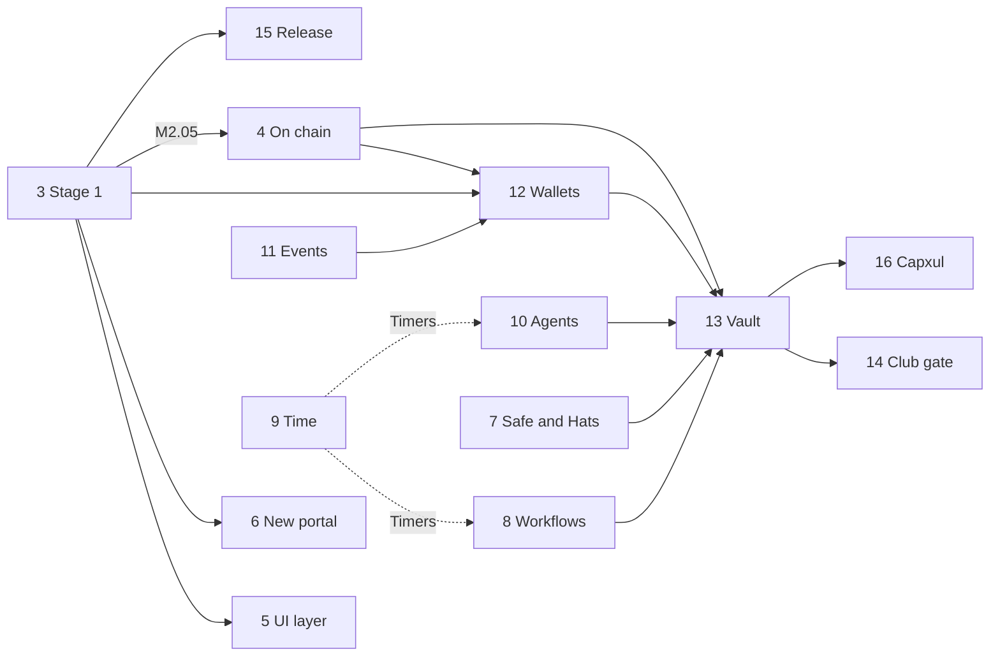

# The goal map

Every goal from here to 1.0 and Capxul, drawn by the 🎼 conductor on 21 November 2026 at Aaron's ask: "we need a map
of all of the goals … we want to make them as independent as possible … so we can parallelize these". Each goal runs
in any harness and coordinates through git and GitHub (K32, K33): one brief, one branch, one milestone, one done
check. The slices come from `design/milestones.md`; this page groups them into goals and says what each needs, and
K34 makes those needs, not milestone order, the rule for when a goal may build.

## How a goal stays independent

1. **It owns paths, and only its own.** A goal's brief lists the packages and folders it owns. Anything outside them
   is an Ask issue to the owner (K32, K33).
2. **New work is a new package or a new module.** A goal that adds to the core (`orthograph`, the compiler, a host)
   adds new modules only, and proves that a blueprint not using them generates byte for byte what it did before (the
   rule K31 set for the app map).
3. **Every shared seam has one owner** (below). Another goal that needs the seam changed asks its owner.
4. **A goal may start before what it needs has landed** by writing its journeys and checks first, red, against the
   seam's agreed shape. Only its build slices wait.

## The shared seams and their owners

| Seam | Owner | Why it is shared |
|---|---|---|
| `orthograph` (the Blueprint API) and the compiler's model | Goal 3 until the beta, then each goal adds its own module | every goal declares through it |
| `host-cloudflare` | Goal 3 until auth leaves the host (M2.05), then Goal 4 (the host plugin kind, its slice 1) | sign-in, chain hosts and workflows all run in it |
| `Timers`, the world's clock and counted work | Goal 9 | workflows, agents, the chain follower and moves made by time all wait through it |
| The workflow engine | Goal 8 | signatures (stage 3), notifications, the factory's manager |
| `chain-evm`, the relayer and follower | Goal 4 | wallets (stage 2) and the vault (stage 3) |
| `@orthograph/web` and the generated pieces | Goal 5 | every app screen and the new portal's forms |
| The portal client and the theme | Goal 6 | every face a feature adds |
| `prove`'s publish and the release path | Goal 15 | the preview and every release |

## The goals

Status: **done**, **running**, **ready** (brief written, branch cut), **planned** (on this map, brief to write).

| Goal | What it delivers | Release | Status | Owns | Needs before it can build |
|---|---|---|---|---|---|
| 1 · The whole framework, locally | layers 1 and 2: blueprint to proof on one machine | — | done | — | — |
| 2 · Land and rename (M0) | Orthograph's name and the repository's shape | — | done | — | — |
| 3 · Stage 1 of Plugged In | the preview's last M1 slices, all of M2 (people, roles, auth and organisations as plugins, secrets, `ortho new`), the handles plugin, staging up and destroy | Preview, Beta | running (Claude) | `goal/stage-1`, M1, M2, ST1, M7.03 to M7.04 | — |
| 4 · On chain, end to end | M6: the chain store, Solidity output, Foundry and fuzz, the Safe host, the client, relayer, follower, signing, worlds with a chain | 1.0 | running (Claude) | `goal/on-chain`, `language-solidity`, `chain-evm`, `examples/budgets` | its host slice waits for M2.05 (Goal 3) |
| 5 · The UI layer | an action and a UI SDK piece per operation, `@orthograph/web`, Plugged In's three screens | Beta | ready | `goal/ui-layer`, `@orthograph/web`, `generated/actions`, `generated/web`, Plugged In's `src/web` | its sign-in screen waits for M2.05; the handle screens for the handles plugin (Goal 3) |
| 6 · The new portal | the theme, the app map in the blueprint, the shell, `portal-next`, then one cutover | Beta | ready | `goal/portal`, `packages/portal-next`, the theme package, the map modules | the cutover waits for Goal 3's yes on a freeze |
| 7 · Safe, Hats and budgets | the spike stage 3 starts from: a Safe, Hats and a budgets module on Anvil | 1.0 | done (lands by #294) | `spikes/safe-hats-module` | — |
| 8 · Workflows | `Blueprint.workflow` (M3.01) on the Cloudflare engine the spike proved (#289): activities, waits on events, durable clocks through `Timers`, replay that skips finished steps | 1.0 | planned | a new `@orthograph/workflows`, its host module, `examples/workflows` | `Timers`' shape from Goal 9 (agree it first; build beside it) |
| 9 · Time | M8: the world holds the clock, `Timers` across processes, moves made by time, the on-time eval, `ortho dev`'s scaled clock | 1.0 | planned | `Timers`, the world's clock, M8's checks | none to start; M8.17 waits for Goal 4's follower |
| 10 · Agents | M4.01 to M4.10, M4.16, M4.26: a durable agent run, model adapters and a stand-in model, tools from operations, `@orthograph/agents`, the portal's chat on it | 1.0 | planned | `@orthograph/agents`, `@orthograph/anthropic`, the stand-in model | none to start; its waits go through Goal 9's `Timers` |
| 11 · Events in and out | M5.01, M5.03, M5.04 and M3.08, M3.16: `on:` for events, doors that verify signatures, `emits:`, the outbox | 1.0 | planned | the events and outbox modules, their host parts | M5.01's decision first (where views live) |
| 12 · Wallets: stage 2 | ST2.01 to ST2.06 and M2.13: create a wallet, link your own with SIWE, pay by handle, the browser signer in Chromium | 1.0 | planned | Plugged In's wallet feature, the ABI adapters (ST2.02), ST2's journeys | Goal 3's stage 1 gate; Goal 4's relayer and follower; Goal 11's `on:` |
| 13 · The vault: stage 3 | ST3.02 to ST3.08: budgets as a feature, the `safe` and `hats` adapters, owners' signatures as a workflow, Plugged In's `/@group`, an agent spending under its hat | 1.0 | planned | `@orthograph/budgets`, ST3's journeys | Goal 4 (Solidity, Safe host), Goal 7 (done), Goal 8 (signatures), Goal 10 (the agent) |
| 14 · The club: stage 4 | ST4.01 to ST4.08: Noir on Aztec, private budgets and ballots, `language-noir`, `chain-aztec` | 1.0 | planned | `language-noir`, `chain-aztec`, `@orthograph/ballots`, `spikes/aztec-club` | none to start: its spike (ST4.01) is the first slice; its gate waits for stage 3 |
| 15 · Release and the cloud | M1.51 (the npm preview), M7.02, M7.05, M7.06, M7.13, M7.14: npm, Homebrew and GitHub releases, signed verdicts from CI, monitors to the sink, and an own CI runner if Aaron says yes | Preview, 1.0 | planned | `prove`'s publish, the release tooling, `tools/ci` | each credential needs Aaron's written yes; the preview needs Gate M1 on `main` |
| 16 · Capxul on Orthograph | M7.10 and M7.11 and the Capxul calls of 20 November: which plugins exist, which are new, which are Capxul's own; then its first feature in its staging | 1.0 and after | planned | `decisions/M7-capxul.md`, Capxul's own repository | M7.10's mapping can start now; the feature needs stage 3 (Goal 13) |

Off the 1.0 path, kept for later and not a goal yet: the factory and the work board (M3.04 to M3.26 apart from the
slices above), the builder's tools and workspaces (M4.11 to M4.25), Stripe, Resend and the other adapters (M5.05 to
M5.15), and the Foreman (`design/foreman/`), which these build towards.

## What can run at once

- **Now, side by side:** Goals 3 and 4 (running), 5 and 6 (ready), and of the planned ones 8, 9, 10, 14, 15's
  preview half, and 16's mapping. None of these waits on another's build; 8, 9 and 10 agree `Timers`' shape first.
- **Once the beta lands:** Goal 11 builds; Goal 12 starts its build slices (its journeys can be written earlier).
- **Once stage 2 and Goals 8 and 10 land:** Goal 13, then Goal 14's gate and Goal 16's feature.

## Starting a planned goal

The conductor writes its brief in K33's shape (front matter, the plain goal card, its slices, its owned paths, its
done check, its one-line start), cuts and protects its branch, and the sync gives it a milestone, a goal issue and a
sub-issue per slice. Aaron then starts it in any harness: "You lead Goal <n>. Read `AGENTS.md` and
`design/goals/<nn>-<name>.md`, and run it."
