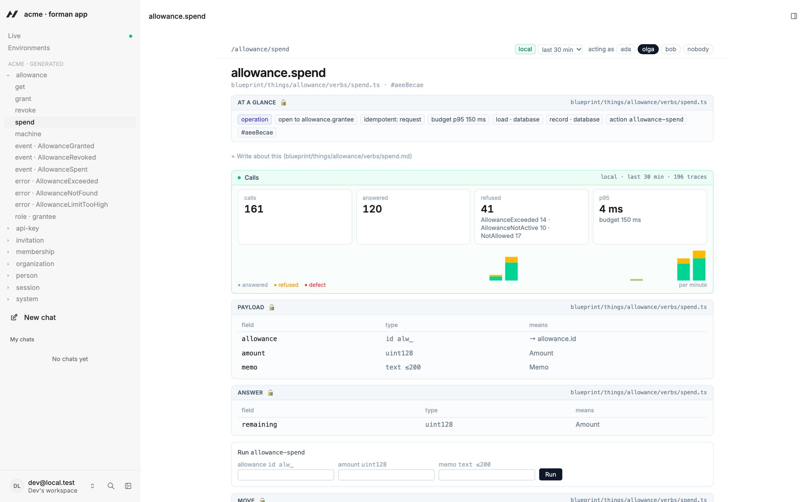

# The app's UX: three kinds of content, one place for each

Pass 3, 18 November 2026. Aaron's word on pass 2: it "kinda worked but the ux was not great". He wants something
simple and purpose-built, with agent-native as a source of ideas only. This pass says what was wrong, then what fixes it.
The sketches in `sketches/` show the fix with acme's real model and real spans; `shots/` holds them.

## The three kinds of content

| Kind | What it is | Where it comes from | Changes when |
|---|---|---|---|
| **Generated** | what the system *is*: payload, answer, who may call, refusals, machine, events | `model.json`, drawn on every view | the code changes |
| **Written** | what people and agents *mean*: why, notes, plans, research, conversations | prose files beside the declarations, and the app's own notes | someone writes |
| **Live** | what the system is *doing*: calls, outcomes, timings against budget, traces | the Collector's files for the environment in scope | every second |

The UX question is where each one sits, so you can tell them apart without reading a label, and how they meet.

## What was wrong

### The portal spike (PR #39)

1. **Everything at the same volume.** Spend's page held about twelve blocks: badges, four KPIs, a 24-hour chart, a
   traces table, two waterfalls, span attributes, docs for the selected span. Nothing says "this is fine" or "look
   here" first. It is a Grafana board pasted onto a docs page.
2. **What it is and what it's doing were on different tabs.** Docs, Calls, Traces, Logs, Refusals. Reading the
   refusal rule and seeing how often it fired took two tabs.
3. **Writing had no home.** "Work: Board, Docs" was bolted on at the bottom of the sidebar, apart from what it was about.
4. **Two trees of the same things.** Catalog › Things › allowance, and again Reference › Operations, Events, Errors.
5. **Dark, dense, monospace everywhere.** Good for a trace; hard for prose.
6. **Environments as top-level tabs** (local, staging, production) when only local exists.

### The agent-native prototype (pass 2, this PR)

The pass-1 sketches it was built from are in `shots/pass-1/`.

1. **One long column.** At a glance, prose, calls, payload, answer, the run form, recent calls, the trace: all stacked.
   "Is spend OK?" sits halfway down, between the prose and the payload.
2. **Every block wears a frame.** A grey header with a lock for generated, a green header with a dot for live. The kind
   is shouted on every block instead of shown by where the block sits.
3. **Too many thin pages.** 44 pages, one per declaration. An error's page is one row of a table; an event's is three.
   The tree became a flat list of `event ·` and `error ·` prefixes.
4. **The run form sits in the middle of reading**, and "acting as" sits on every page, though it matters only when you
   call.
5. **The chat was hidden**, and the template's own chat list ("New chat · My chats") competed with the tree.

## What fixes it: five rules

1. **Place tells kind.** Every declaration page has the same two columns.
   - **The reading column** (left, wide): written words first, then the generated contract. Prose is in the body font
     with its author on one quiet line. Generated parts are tables and diagrams with a small "from `spend.ts`" foot.
   - **The live rail** (right, narrow): one green dot in its header, then the status sentence, a sparkline, the
     outcome counts and the last calls. Nothing live appears in the reading column, and nothing written in the rail.

   No block frames. You know what you are looking at by where it is.
2. **Lead with one sentence.** The page header says what the thing is (the prose's first line, or the model's
   description) and how it is doing, in words: "291 calls in 30 min · p95 4 ms of 150 · 83 refused, none defects".
   The rail's numbers back the sentence up; they don't replace it.
3. **Join only where the join answers a question.** The one place generated, written and live meet in a row is the
   **refusals table**: the declared refusal, its code, a written note if there is one, and how often it fired in the
   window. The operations list on a thing's page does the same: each verb, who may call it, and its live status.
   Everywhere else the three stay apart.
4. **Fewer, fuller pages.** A thing's page carries its machine, events, errors and roles as sections, reachable by
   ⌘K and by anchor. An operation keeps its own page. 44 pages become 25: home, environments, 8 things and 15 operations. The tree shows things and their verbs, nothing else.
5. **Detail comes to you, in a drawer.** A trace, a "Try it" form and the chat each open as a drawer over the rail,
   never as another block in the column. Closing it puts you back where you were.
   - **Trace drawer:** the waterfall, who the app called as, and the rule that refused it, with a link to that rule.
   - **Try it:** the form generated from the payload, with "acting as" inside it (F6 #4). The answer lands at the top
     of the rail's calls, highlighted.
   - **Chat:** knows the page, the window and any open trace; a conversation can be kept as a note.

## Across screens

| Screen | Answers | Reading column | Live rail |
|---|---|---|---|
| **Home** | Is anything wrong right now? | Operations that need attention first (defects, over budget, high refusal rate), then all of them; notes that went stale | the whole system's sparkline and counts, last refusals |
| **Thing** (allowance) | What is it, and how is it used? | prose, operations list (joined), machine with live move counts, refusals table (joined), events, roles | the thing's calls |
| **Operation** (spend) | What does it take, who may call, how is it doing? | prose, payload, answer, who may call, refusals table (joined), steps | status sentence, sparkline, outcomes, last calls → trace drawer |
| **Note** | What did someone write? | the note, with any block dropped in by reference | nothing, unless the note embeds a live block |
| **Environments** | What runs where? | declared environments | which are running, and the last call seen |

The sidebar: **Home**, then the **things** (each opens to its verbs), then **Notes** (pages people and agents wrote,
and kept conversations), then **Environments**. The top bar holds the page's place, one scope control
("local · last 30 min") and ⌘K. The chat button sits in the top bar; its history is in the chat drawer, not the
sidebar.

## Aaron's four answers (F6), under this UX

| # | Answer | Still holds? | Where it shows |
|---|---|---|---|
| 1 | One tree, live inside each page | Yes | the live rail on every declaration page; no separate observability section |
| 2 | Blocks by reference, prose pinned to a hash | Yes | generated parts drawn from the model each time; prose shows amber with the change when its hash moves |
| 3 | Prose about a declaration beside it in the repo; the rest in the app | Yes | operation and thing prose from `verbs/spend.md` etc.; notes and kept conversations in the app |
| 4 | Locally, act as a cast member | Yes, moved | inside the Try it drawer, not on every page |

## The look

An internal tool: HeroUI's components and defaults (light, Inter, soft radius, one accent), monospace only for names
from the code. Status colours mean one thing each: green answered, amber refused (the system said no, as designed),
red defect (the system broke). Amber is not an alarm.
