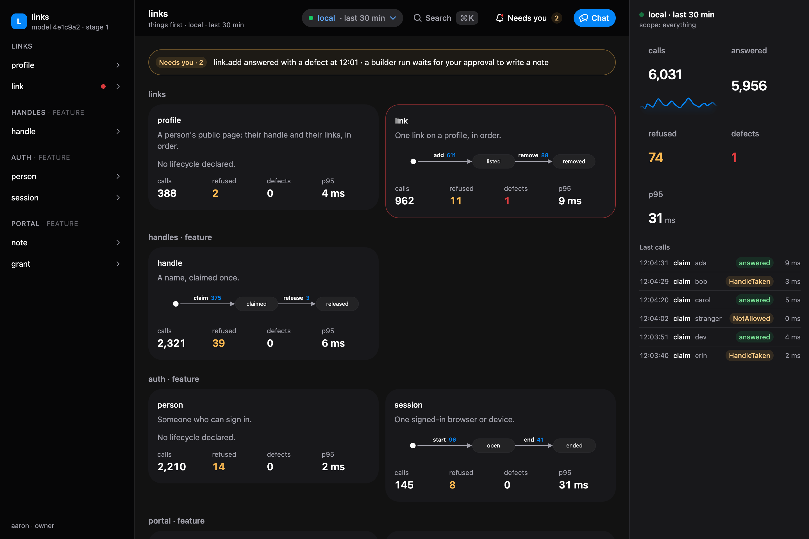
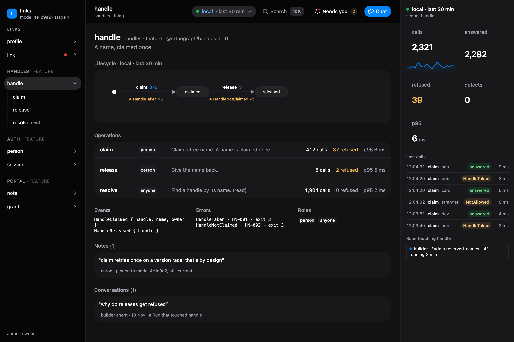
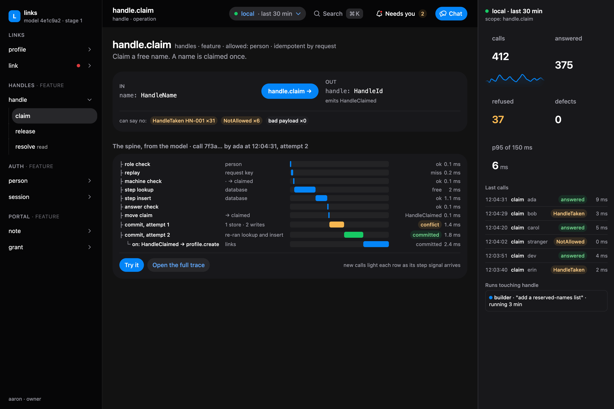
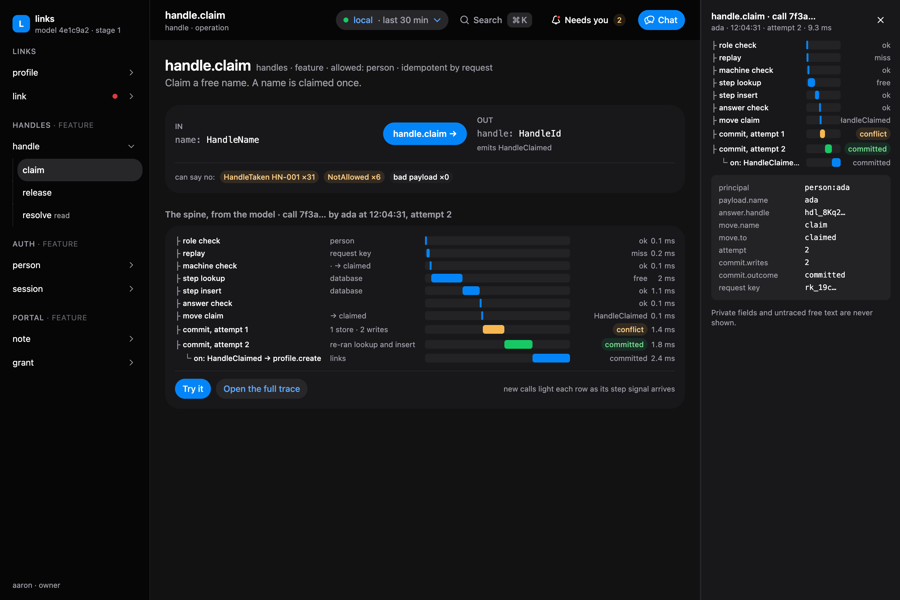
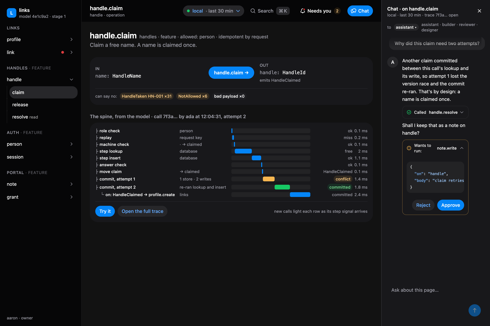
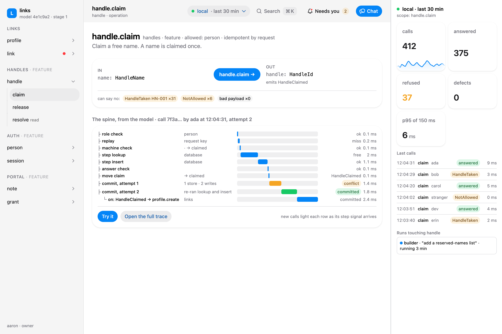

# The portal mock (M1.25)

**Question.** What do the pages agreed in [`design/portal.md`](../../design/portal.md) look like on HeroUI Pro, with
`links` at stage 1 as the app?

**Answer.** The drawing below. Every label, list and diagram is what the model would generate; every number is what
the window's telemetry would give. Nothing here is wired: the data is fixed in `src/data.ts`.

## What was tried

HeroUI Pro `@heroui-pro/react` 1.0.0-beta.11 on `@heroui/react` 3.2.7, the versions the kanban and fumadocs spikes pin,
with Pro's `AppLayout`, `Sidebar`, `Navbar`, `KPI`, `ChatConversation`, `ChatMessage`, `ChatTool` and `PromptInput`.
Pro installs from Aaron's `heroui-pro login` on this machine (its postinstall downloads the licensed build), in this
spike's own pnpm workspace, so CI never installs it. Only our code and the screenshots are committed: the repository is
public, and Pro's licence (section 3) forbids publishing any part of its package.

```bash
pnpm --dir spikes/portal-mock install && pnpm --dir spikes/portal-mock dev   # http://127.0.0.1:45691
```

Pages by query string: `?page=home`, `?page=thing&thing=handle`, `?page=op&thing=handle&op=handle.claim`, with
`&drawer=trace` or `&drawer=chat`, and `&theme=light`.

## The pages

**Home: things first** (Q2). One card per thing, grouped by where it came from (Q3): its lifecycle strip with move
counts, and its numbers. `link` is red: one defect.



**A thing: its lifecycle first** (Q4). Move counts on each arrow, each refusal on the arrow it guards, then its
operations, events, errors, roles, notes and the conversations that touched it. The rail shows a builder Run working
on `handle`.



**An operation: in and out, then the spine** (Q5). The call shown lost a version race on its first commit, committed
on the second, and created the profile through `on:`.



**The trace drawer**, over the rail, and **the chat** (Q7): a Run that knows the page and the open trace, with a tool
call answered and one waiting for approval.

| trace | chat |
|---|---|
|  |  |

**Light theme.**



## What was found

1. **Pro's shell carries the frame as designed.** `AppLayout`'s sidebar is the tree, its navbar the top bar, its aside
   the live rail; a drawer replaces the rail's content in place.
2. **Pro's `Sidebar.Menu` folds a thing to its operations** with no code of ours, and its sections give the groups.
3. **`KPI` with `KPI.Chart` is the stat block and sparkline**; numbers stay data, never sentences.
4. **`ChatTool` draws an action's states as K10 maps them**: `output-available` for an answer, `requires-action` with
   approve and reject for an approval.
5. **The lifecycle and the spine are ours.** Pro has no state diagram and no waterfall: both are small SVG and grid
   components (`src/parts.tsx`, `src/spine.tsx`), about 90 lines together.
6. **The rail is narrow for a trace.** In a 340 px rail, long row names truncate. The real drawer opens wider.

## Open risks

- Pro's code can't go into this public repository. The real portal imports it through `@orthograph/portal-ui` as a
  peer dependency, never bundled (F7, `design/decisions/F7-portal-ui-seam.md`).
- The spike uses fixed data, `setTimeout`-free but outside the package rules: throwaway code, never imported.
